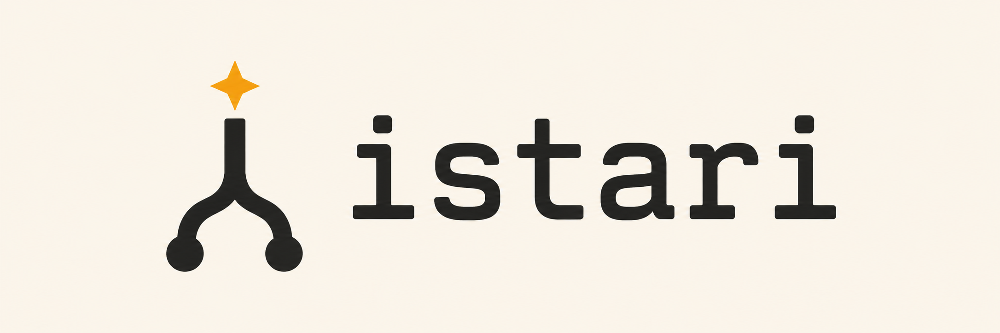
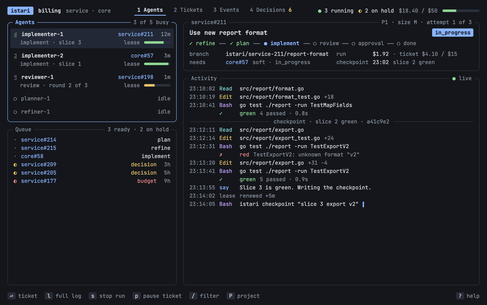

# istari

<p align="center">
  
</p>

istari is a self-hosted system that runs the software development lifecycle for coding agents. It takes a ticket and carries it to a merged pull request through a fixed pipeline of stages that agents execute under human control.

> **Status: early, M1–M3 implemented.** istari syncs tickets from GitHub Issues, runs agents from a task queue in a git worktree per ticket, and takes a ticket through the refine, plan and implement stages to a draft pull request. Slack, the TUI, and the review and merge stages are not built yet. To try it, follow the [setup guide](docs/setup.md).



## How it works

1. **Anyone creates a ticket.** A person in the tracker, an agent in a terminal session, or a message in Slack. GitHub Issues is the default tracker.
2. **istari brings the ticket to the standard.** Code checks its structure; a refiner agent checks its quality and rewrites it if needed. Only an admitted ticket goes to work.
3. **Agents pull work from a queue.** Nobody assigns tasks. A free runner slot claims the ready task with the highest priority and starts a harness for it in the ticket's own git worktree.
4. **The ticket moves through the pipeline.** Refine, plan, implement, review, approve, merge. Each stage is one short-lived agent run.
5. **A human decides what only a human should.** Decision cards, questions and pull requests ready for review arrive in a Slack channel. Everything decided is written back to the ticket.
6. **Code merges.** Depending on the merge mode, after human approval or automatically for small, reversible changes.

## Principles

- **No ticket, no work.** An agent can only run as the worker of a ticket's task. A required CI check rejects pull requests without a ticket.
- **The ticket is the memory.** Decisions, answers, assumptions, the plan and checkpoints live in the ticket. Slack, harness sessions, worktrees and istari's own database are disposable, so work can resume at any moment, with another agent or harness.
- **Less model, more deterministic code.** Models do only what needs judgment. Their output is structured, validated by code, and never trusted for claims such as "the tests are green". State transitions and merges are performed by code.
- **Any harness, any provider.** Harnesses run as external programs behind an adapter. Claude Code is the first one.
- **No orchestrator agent.** Scheduling, priorities, dependencies, change zones and the merge queue are plain code.

## Interfaces

| Interface | Purpose |
|---|---|
| CLI (`istari`) | Control for people and the way agents talk to istari |
| Slack | Communication: ticket threads, a decisions channel, the morning report |
| TUI (`istari top`) | Monitoring: agents, tickets, events, decisions |

## Documentation

- [Setup guide](docs/setup.md): install, configure and run istari, from the first ticket to a draft pull request.
- [Design spec](docs/design.md): architecture, ticket state machine, ticket standard, pipeline, Slack, agents, CLI, TUI, configuration.
- [TUI mockups](docs/tui/mockups.html): the four screens. They are part of the spec.
- [AGENTS.md](AGENTS.md): rules for coding agents that work in this repository.

## Roadmap

| Milestone | Result |
|---|---|
| [M1 Core](https://github.com/sbraznikov/istari/issues/1) | Two processes share one task queue correctly |
| [M2 Tickets](https://github.com/sbraznikov/istari/issues/2) | An admitted GitHub issue becomes `ready` and produces tasks |
| [M3 Execution](https://github.com/sbraznikov/istari/issues/3) | A raw ticket becomes a draft pull request; interrupted work resumes |
| [M4 Slack](https://github.com/sbraznikov/istari/issues/4) | Tickets left overnight produce pull requests and a morning report |
| [M5 TUI](https://github.com/sbraznikov/istari/issues/5) | Live monitoring that matches the mockups, with themes |
| [M6 Pipeline completion](https://github.com/sbraznikov/istari/issues/6) | A ticket goes all the way to merge |
| [M7 Expansion](https://github.com/sbraznikov/istari/issues/7) | More trackers, container isolation, remote runners, Postgres |

## Required check: `istari/ticket-link`

A pull request must reference an open ticket: its branch is `istari/<issue-number>/<slug>`, or its commits carry the trailer `Ticket: gh:owner/repo#<number>`. The check fails a pull request with no reference, or one that references a closed or canceled ticket, and says why. istari's own branches and commits always carry both.

Add the workflow to the repository:

```yaml
# .github/workflows/istari.yml
name: istari
on:
  pull_request:
    types: [opened, edited, synchronize, reopened]
permissions:
  contents: read
  issues: read
  pull-requests: read
jobs:
  ticket-link:
    name: istari/ticket-link
    runs-on: ubuntu-latest
    steps:
      - uses: sbraznikov/istari/.github/actions/ticket-link@main
```

Then make `istari/ticket-link` a required status check in the branch protection rules (or ruleset) of the main branch, so that no pull request merges around istari. The same check runs locally with `istari ci ticket-link --repo owner/repo --pr <number>`.

## Contributing

All work goes through tickets. Pick an open issue whose dependencies are closed, work on a branch named `istari/<issue-number>/<slug>`, and open one pull request per ticket. New tickets follow the ticket standard described in [section 4.5 of the spec](docs/design.md).

## Acknowledgements

The task and lease model is adapted from [Vercel Board](https://vercel.com/blog/introducing-vercel-board). The working rules of the implementer and reviewer roles follow [Matt Pocock's skills](https://github.com/mattpocock/skills).
