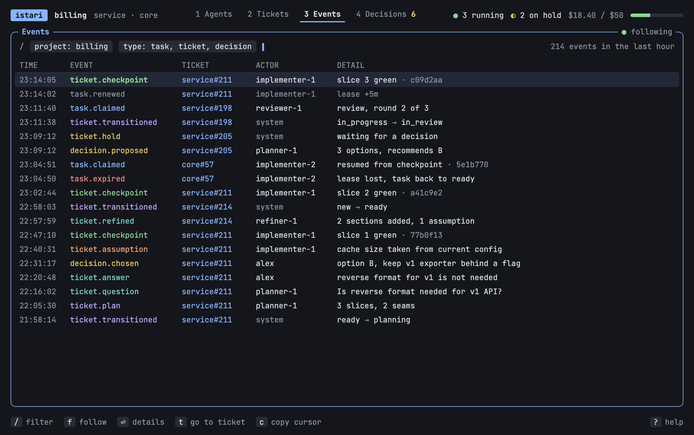
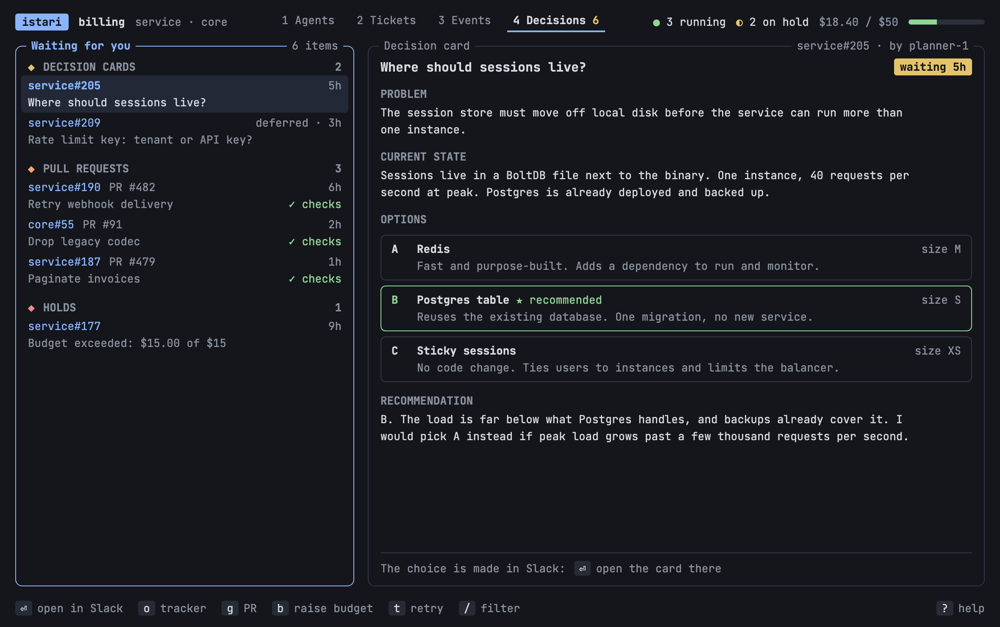

# istari: technical and architectural design

Status: draft v0.9 · 2026-11-23

istari is a self-hosted SDLC management system for agents. It turns a ticket into a merged PR by taking it through a fixed pipeline of stages that agents execute under human control.

The requirements the design starts from:

1. Work happens only through tickets: no ticket, no work. The tracker is pluggable; the default is GitHub Issues.
2. Anyone can create a ticket, in any way. Before work starts, istari checks it against the standard and, if needed, brings it into the required form.
3. Creating tickets is separate from working on them. There is no orchestrator agent: istari itself distributes tasks, and agents pick them up from a queue.
4. Slack is only a communication channel, including between agents. Everything that follows from the communication (decisions, questions and answers, assumptions) is recorded in the ticket.
5. Work on a ticket can be resumed at any moment after any failure: everything needed for that is in the ticket, the branch and the PR.
6. Control is through the CLI, monitoring through the TUI.
7. A project is one repository, or several from which one service is built.
8. Every ticket has its own worktree (git worktree). It is deleted after the PR is approved and merged.
9. PR merging is set in the config, including the auto-merge mode.
10. Tickets are estimated only in T-shirt sizes.
11. The TUI supports themes.
12. Tickets have a priority. Links and overlaps between tickets are tracked by istari itself (section 4.9).
13. Less model, more deterministic code: the model does only what requires judgment, and its result is accepted by code (section 7.7).

---

## 1. What we take from Vercel Board and what we do differently

Vercel Board (announced on 18.11.2026) is a "headless communication primitive and message store" for agents: channels, threads, labels, tasks with a lease, a single event log, grants, two-way sync with Slack. It is a general-purpose primitive, not an SDLC system: a development pipeline, gates and merge are not described in it and are left to the user.

| Board idea | Decision in istari |
|---|---|
| Workers pick up tasks from the queue themselves (`claim`); nobody assigns a task to a specific worker | Take. A worker is a Runner slot: it picks up a ready task of the required role and starts a harness for it, like `tasks run --ready … -- your-agent` in Board |
| The Lead role from the swarm guide: an agent that plans and hands out work | **Do not take.** The daemon distributes tasks with ordinary code, and input quality is ensured by checking the ticket against the standard |
| A lease with renewal; the latecomer gets `claim_lost` | Take unchanged. This is the basis of resilience to agent crashes |
| `needs` dependencies, `waiting → ready` states | Take. Pipeline stages are tasks in a DAG |
| One ordered event log per board, opaque cursors, `tail`/`wait` | Take. The log is the only source for the TUI, the Slack sync and the audit |
| Actor profiles ("fx via ada"), path-based grants | Take in simplified form: role + scope (repository) |
| Credentials outside the sandbox, access through a network policy | Take the principle: the agent's environment holds only a short-lived run token |
| Harness agnosticism through CLI + skill | Take. The agent talks to istari through the same CLI |
| The thread is the primary entity, the task is a layer on top of the thread | **Change.** The primary entity is a ticket in an external tracker. The Slack thread and the tasks are derived from it |
| GitHub sync is inbound only | **Change.** The tracker is the source of truth; we write status and links to it |
| No pipeline, gates or merge | **Add.** This is exactly the subject of istari |
| Serverless watchers on Vercel | **Change.** One long-lived daemon, self-hosted |
| Failed tasks are not restarted, an attempt limit is not described | **Add.** An attempt limit and per-ticket budgets |

---

## 2. Domain model

```
Project ──< Ticket ──< Task ──< Run ──< Event
              │          │
              │          └── needs (DAG between tasks)
              └── SlackThread (1:1)
```

| Entity | Where it lives | Description |
|---|---|---|
| **Project** | istari | One or more repositories of one service + a tracker + a Slack channel |
| **Ticket** | external tracker (truth), mirror in istari | A unit of work. Belongs to exactly one repository. Identifier of the form `gh:owner/repo#123` |
| **Task** | istari | One pipeline stage for one ticket. Has a role, a state, a lease, `needs` |
| **Run** | istari | One attempt to execute a task by one agent. Harness process + worktree + transcript |
| **Event** | istari | An immutable record in the log. Everything else is a projection of the log |
| **Actor** | istari | A human (Slack ID + tracker login) or an agent profile (`implementer-2`) |
| **Gate** | istari | A point where the pipeline waits for a human decision |

Separation of responsibility: the ticket, the branch and the PR store everything needed for the work; istari stores only who is currently executing what. Slack, harness sessions, workspaces and the istari database itself are considered expendable: if they are lost, work resumes from the ticket (section 4.6).

### 2.1 The "no ticket, no work" invariant

The invariant is enforced at five levels, so that it cannot be bypassed through any interface:

1. **Storage.** The store has a single write path, `Append`, and core refuses to append a task without its ticket; runs, once they exist, are refused without their task in the same way. Projections are stored as generic records, so the schema itself does not express this; instead a test pins the store's exported API, so that no second write path can appear. A run without a ticket cannot be written.
2. **API.** The API has no "start an agent with an arbitrary prompt" operation. A working agent is started only as the worker of a ticket's task.
3. **Ticket standard.** Anyone can create a ticket: a human in the tracker, an agent in any harness, a message in Slack. But only a ticket that has passed the standard check and admission gets into work (section 4.5).
4. **Git.** The branch is named `istari/<ticket-key>/<slug>`, and every commit carries the trailer `Ticket: gh:owner/repo#123`. The run token grants the right to push only to branches with this prefix.
5. **CI.** The required check `istari/ticket-link` rejects a PR without a link to an open ticket. This closes the path around istari.

There are no agents working outside a ticket. Even the refinement of a ticket is a task of that same ticket.

---

## 3. Architecture

```
        Slack                    GitHub / Linear / Jira
          │ Socket Mode                 │ webhooks + REST
┌─────────┴─────────────────────────────┴──────────────┐
│                      istarid                         │
│                                                      │
│  Slack Gateway    Ticket Sync      VCS Adapter       │
│        │               │                │            │
│        └───────┬───────┴────────┬───────┘            │
│                ▼                ▼                    │
│        ┌──────────────────────────────┐              │
│        │   Core: Event Log + Tasks    │◄── Scheduler │
│        │   (SQLite, WAL)              │    (leases,  │
│        └──────────────┬───────────────┘    timers)   │
│                       │                              │
│   Pipeline Engine ◄───┤───► Policy (grants, budgets) │
│                       │                              │
│                 API: gRPC/HTTP + SSE                 │
└──────┬────────────────┬──────────────────┬───────────┘
       │ unix socket    │                  │
   istari CLI      istari top (TUI)    Runner(s)
                                           │
                                  ┌────────┴────────┐
                                  │ Workspace       │
                                  │ git worktree /  │
                                  │ container       │
                                  │  └ harness      │
                                  │     └ istari CLI│
                                  └─────────────────┘
```

A single `istari` binary contains the daemon (`istari daemon`), the CLI and the TUI. In the first version the Runner is built into the daemon; later it is moved into a separate process so it can run on other machines.

**The unit of work is the project.** `istari init` in a repository creates a project: its own Slack channel, its own tickets and budget. By default a project is one repository. If a service is built from several repositories, they are added to the same project with the `istari repo add` command (section 4.4). Each repository keeps its own pipeline (`.istari/pipeline.toml`). Projects do not see each other.

**One daemon per machine.** It serves all registered repositories. A separate daemon per repository does not work for three reasons:

- Slack in Socket Mode delivers each event to only one of the app's connections. Several daemons with one Slack app would lose each other's events, and a separate app per repository is extra setup.
- The limit on parallel runs and the daily budget make sense per machine, not per repository.
- One TUI shows the agents of all repositories, with switching between them.

### 3.1 Components

**Core.** The event log and the projections (tickets, tasks, runs). All state changes go through one function, `Append(event)`, in a transaction together with the projection updates. Claiming a task is a conditional `UPDATE ... WHERE state='ready'`, so out of two simultaneous `claim` calls exactly one wins.

**Pipeline Engine.** When a ticket moves to `ready`, it expands the pipeline template into a set of tasks with `needs`. It reacts to task completion: opens the next tasks, creates gates, returns work for rework.

**Scheduler.** Lease expiry, deferred checks ("look at CI in 5 minutes"), gate timeouts, concurrency limits.

**Ticket Sync.** The tracker adapter: webhooks inbound; labels, comments and status written outbound. Plus a periodic reconciliation in case a webhook was missed.

**Slack Gateway.** Socket Mode: an outbound WebSocket connection, no public URL needed. It projects events into threads and turns messages, buttons and slash commands into Core commands.

**VCS Adapter.** Branches, PRs, CI statuses, reviews, merge. The default is a GitHub App with short-lived installation tokens.

**Runner.** Picks up tasks, prepares the workspace, starts the harness, renews the lease, streams the transcript to Core.

**Policy.** Checks who can do what: human roles, agent profile permissions, budgets.

### 3.2 Stack

The decision is **Go**:

- one static binary for the daemon, the CLI and the TUI, simple installation;
- Bubble Tea + Lip Gloss for the TUI, Cobra for the CLI;
- SQLite in WAL mode (`modernc.org/sqlite`, no cgo) behind a storage interface that Postgres can later fit under;
- harnesses are started as subprocesses, so there is no binding to a specific vendor's SDK.

An agent can be run in two ways. The first is as an external program: istari starts a ready-made harness (t3code, Claude Code, Codex) as a separate process and talks to it through its input and output. The second is as a library: an agent SDK is linked into the istari code, and the agent loop runs inside the daemon process. This is what "embedding the SDK in the process" means. It gives finer control over each step of the agent, but ties you to the SDK's language (usually TypeScript or Python) and to a specific vendor.

The "any harness and any provider" requirement is met only by the first way, so istari works with harnesses as external programs, and the language of istari itself does not depend on them.

---

## 4. Lifecycle

### 4.1 Ticket states

A ticket is a state machine with eight states and an independent hold flag.

```
new ──► ready ──► planning ──► in_progress ──► in_review ──► awaiting_approval ──► done
                                    ▲               │                 │
                                    └───────────────┴─────────────────┘
                                            return for rework

any unfinished state ──► canceled ──► new (reopen)
```

| State | Meaning | Who works |
|---|---|---|
| `new` | The ticket is created and is being checked against the standard; if needed, it is refined to meet it | refiner, the author if there are questions |
| `ready` | The ticket meets the standard and is admitted to work, waiting for a free worker | — |
| `planning` | The technical plan is being drawn up | planner |
| `in_progress` | Code is being written, CI is running | implementer |
| `in_review` | An agent reviews the PR | reviewer |
| `awaiting_approval` | The PR waits for human review and merge | human |
| `done` | The PR is merged, the ticket is closed. Final state | — |
| `canceled` | Work has been stopped | — |

**Transitions.** There are no other transitions; an attempt to perform a transition outside the table is rejected.

| # | From | Event | To | Who initiates | Condition |
|---|---|---|---|---|---|
| T1 | — | `create` | `new` | anyone: a human, an agent, a Slack message | — |
| T2 | `new` | `accept` | `ready` | system | the ticket meets the standard and is admitted (section 4.5) |
| T3 | `ready` | `start` | `planning` | system | there is a free slot, there is no hold, the tickets in `needs` are completed; among the ready tickets the one with the highest priority is taken |
| T4 | `planning` | `plan_accepted` | `in_progress` | system; a human, if the plan gate is enabled | the plan is published in the ticket; the change zone does not overlap with tickets in progress, otherwise hold `waiting_zone` |
| T5 | `planning` | `split` | `in_progress` | planner | child tickets are created; the parent has no tasks of its own. Mandatory if the ticket size is larger than `max_size` |
| T6 | `in_progress` | `pr_ready` | `in_review` | system | the PR is open, CI is green, and the PR is marked ready for review (no longer a draft); while marking fails, T6 does not fire and is retried |
| T7 | `in_review` | `changes_requested` | `in_progress` | system, based on reviewer findings | the accepted reviewer report contains findings; there have been fewer than `max_review_rounds` rounds, otherwise hold |
| T8 | `in_review` | `review_passed` | `awaiting_approval` | system, based on reviewer findings | the accepted reviewer report contains no findings; CI is green |
| T9 | `awaiting_approval` | `changes_requested` | `in_progress` | human via GitHub review | — |
| T10 | `awaiting_approval` | `merge_failed` | `in_progress` | system | a conflict or red CI after the branch is updated. The repeat review is limited to the conflict resolution (section 4.9) |
| T11 | `awaiting_approval` | `merged` | `done` | system or human, depending on the merge mode (section 4.8) | required checks have passed; human approval, if the mode requires it |
| T12 | `in_progress` | `children_done` | `done` | system | the ticket has child tickets, and all of them are in `done` |
| T13 | any except `done` and `canceled` | `cancel` | `canceled` | human | runs are stopped, the PR is closed |
| T14 | `canceled` | `reopen` | `new` | human | — |
| T15 | `ready` | `edited` | `new` | system | the text of the ticket's mandatory sections has changed (compared by hash); editing labels and fixing typos outside these sections does not trigger the check |

`done` is not reopened: a regression is filed as a new ticket with a link to the original one.

**Hold (`hold`).** This is not a state but a flag on top of any unfinished state. While it is set, the ticket's tasks are not handed out to workers, and the state does not change. After it is cleared, the ticket continues from the same place, so the board shows at which stage it got stuck.

| Reason | When it is set | Who clears it |
|---|---|---|
| `needs_input` | an agent asked a question and stopped | human, by replying in the thread |
| `attempts_exhausted` | a task failed `max_attempts` times or the review rounds are exhausted | human, with the `retry` command |
| `budget_exceeded` | the ticket budget is exceeded | human, by raising the budget |
| `paused` | a human paused the ticket | human, with the `resume` command |
| `waiting_dependency` | during the work it turned out that a ticket that is not yet completed is needed, usually in a neighboring repository | system, when the dependency ticket is completed |
| `waiting_zone` | the ticket's change zone overlaps with the zone of another ticket that is already in progress | system, when that ticket is merged or canceled |

**State machine rules.**

- Only Core performs transitions. Every transition is a `ticket.transitioned` event with the fields `from`, `to`, `trigger`, `actor`, so the ticket history can be fully reconstructed from the log.
- The ticket state changes only through the events in the table. Task states (section 4.2) are a finer level inside a single ticket state.
- In GitHub Issues the state is stored as exactly one label `istari:<state>`, and a hold as the label `istari:hold:<reason>`. `done` closes the issue as completed, `canceled` as not planned. In Linear and Jira native statuses are used, according to the mapping table in the adapter config.
- A manual label edit in the tracker is treated as a transition request. If the transition is allowed and the author has the right to perform it, it is applied; otherwise istari restores the label and explains the reason in a comment.

### 4.2 Task states

As in Board, plus an attempt limit:

```
waiting ──(all needs completed)──► ready ──claim──► claimed
                                     ▲                │
              release / lease expired                 ├─ complete ─► completed
                                     │                ├─ fail ─────► failed ──(attempt < max)──► ready
                                     └── unblock ◄── blocked ◄─ block
canceled — from any open state
```

- The lease is 5 minutes by default; Runner renews it at every third of the term.
- After expiry the task returns to `ready`, with the event `task.expired`. Any action by the old owner is rejected with `claim_lost`.
- `max_attempts` is 3 by default. Once they are exhausted, the ticket gets the hold `attempts_exhausted`, and istari reports this in Slack.
- An attempt is a run that fails its task. When code refuses what an agent submits, the refusal counts as an attempt only when it is about the submission itself: a result outside its schema, a YAML error, a finding outside the diff. A refusal about the ticket's state, such as a review submitted while the ticket is not yet `in_review`, is not the agent's fault: the run ends without a result, the task is released to `ready`, and no attempt is spent. The journal records once per task, in a note, that it was handed out before its ticket was in the state it belongs to, with the ticket's state.
- `block --kind` distinguishes the reasons: `needs_input`, `awaiting_approval`, `budget_exceeded`, `ci_red`.

### 4.3 Default pipeline

| # | Stage | Worker | Ticket state | Result | Gate |
|---|---|---|---|---|---|
| 0 | refine | refiner | `new` | a ticket refined to the standard | check and admission (section 4.5) |
| 1 | plan | planner | `planning` | a plan in a ticket comment, including seams for tests (section 7.6) | plan approval: off by default, enabled in the config (`plan_gate`) |
| 2 | implement | implementer | `in_progress` | branch, commits, draft PR | — |
| 3 | verify | (no agent) | `in_progress` | CI status; on green CI the PR is marked ready for review, which ends the draft | CI is green |
| 4 | review | reviewer | `in_review` | a review with comments, or an approval | — |
| 5 | approve | human; skipped in `auto` mode | `awaiting_approval` | GitHub review | depending on the merge mode (section 4.8) |
| 6 | merge | (no agent) | `awaiting_approval` → `done` | merge, closing the ticket, removing the worktree | — |

Rules:

- Reviewer and implementer are always different profiles, and different models where possible. An agent does not review its own code.
- Review comments or red CI create a new `implement` task with `needs` on the original one; the iteration counter is limited (`max_review_rounds`, 3 by default).
- When a merge requires a human, the approval is a GitHub review from a member listed in CODEOWNERS, not a button in Slack. A Slack button is suitable for reversible gates (approve the plan, unblock). Merge modes are described in section 4.8.
- The pipeline is defined declaratively in the repository's `.istari/pipeline.toml`; stages can be removed, added and made parallel.

If a ticket is too large, planner splits it into child tickets (sub-issues). Each of them goes through the check against the standard and its own pipeline. The parent stays in `in_progress` and moves to `done` when all child tickets are completed (T5, T12).

### 4.4 Working across several repositories

A typical case: a service lives in one repository, and one of its components is extracted into another. Both repositories belong to one project: they share a Slack channel, a budget and dependencies between tickets.

**Tickets.** A ticket always belongs to one repository: the issue, the branch and the PR live in it, and the rule "one ticket, one PR" is preserved. A piece of work that touches both repositories is filed like this (manually or by planner when splitting):

```
gh:acme/service#210  "Support the new report format"          parent, main repository
 ├─ gh:acme/component#57  "Add the format to the component"   child
 └─ gh:acme/service#211   "Use the new format"                child, needs: component#57
```

**Order.** A dependency between child tickets is defined through `needs` and comes in two kinds:

| Kind | Behavior | When to use |
|---|---|---|
| `hard` (default) | The dependent ticket starts (T3) only after the dependency is completed. Its brief includes the dependency's result: a commit or a version | The service consumes the component as a published version |
| `soft` | Both tickets proceed in parallel, the service is built against the component branch. The service merge (T11) additionally waits for the dependency to be completed | The contract is agreed in advance, speed is needed |

**What counts as completion of the component.** Configured per repository: `done_when = "merged"` or `"released"`. In the second case the component ticket moves to `done` only after the release is published, and the dependent ticket receives the version number.

The value is chosen automatically. On `istari repo add` istari looks at how the repositories are linked and proposes a setting, which a human confirms:

| What is found | Link type | `done_when` | Build in `soft` mode |
|---|---|---|---|
| a dependency with a version number in a manifest (`go.mod`, `package.json`, `pyproject.toml` and similar) | published package | `released` | the version is temporarily replaced with the component branch; before the merge the release version is restored |
| an entry in `.gitmodules` | git submodule | `merged` | the submodule points to the component branch; before the merge, to a commit from the main branch |
| a reference to a neighboring directory (`replace`, `file:`, `path =`) | local path | `merged` | the neighboring repository is attached on the component branch |
| none of the above | link not determined | `merged` | `soft` mode is unavailable until a human describes the link |

**Workspace.** An agent writes only to the repository of its ticket. The other repositories of the project are attached to the workspace read-only, so that it can see the contract and the actual usage.

**A dependency discovered during the work.** If a worker in the service finds out that a change to the component is needed, it does not make the change itself. It creates a ticket in the component repository and puts its own ticket on hold `waiting_dependency`. The new ticket goes through the check against the standard and inherits the admission. When the component is ready, the hold is cleared automatically.

**Slack.** The project's work channel and decisions channel are shared by all repositories (section 6). The parent ticket and each child ticket have their own threads; the card shows the repository and links to the related tickets.

### 4.5 Ticket standard

Creating a ticket and working on it are separated. For istari it does not matter who created the ticket or how: a human in the tracker, an agent in a `claude` session after working on a specification together, a Slack message, or another agent in the course of its task. Only one thing matters: only a ticket that meets the standard gets into work.

**What the standard is.** Two files in the repository that the project can change: `.istari/ticket-standard.toml` is the schema that code checks, and `.istari/ticket-standard.md` holds the quality requirements for refiner.

| Part | What is checked | By whom |
|---|---|---|
| Structure | mandatory sections ("Context", "What needs to be done", "Acceptance criteria", "Out of scope"), ticket type, T-shirt size, priority, repository, links to dependencies; the dependency graph has no cycles and no links to nonexistent tickets; the file paths mentioned exist in the repository | by code |
| Quality | the acceptance criteria are verifiable; there are no contradictions or ambiguities; the size matches the scope and does not exceed the allowed one; the modules and APIs mentioned exist in the code; the ticket does not duplicate or contradict tickets from the candidate list selected by code | by the refiner agent |

**Check and refinement.** The structural check by code is performed for every ticket in `new`. The refiner is an agent run that costs money, so it works only on a ticket that is admitted once it meets the standard (see Admission): its author is trusted, it was created by an agent working on an admitted ticket, or a trusted member asked to admit it. A ticket of anyone else that falls short waits in `new` for a trusted member. For a ticket the refiner works on:

1. Structural check by code. Code fills in a missing priority with the default value.
2. Code selects duplicate candidates: open and recently completed tickets with matching paths, identifiers and keywords.
3. Refiner reads the ticket, the code and the candidate list and assesses the quality. It submits the result in structured form: verdict, size, list of deviations, list of assumptions.
4. The ticket meets the standard: it proceeds to admission.
5. The ticket does not meet the standard, but what is missing can be derived from its text and the code: refiner rewrites the ticket into the standard form. The original text is kept in a collapsed block at the end of the ticket, and a comment lists what was changed and which assumptions were made. Code checks that the original text is preserved verbatim and repeats the structural check.
6. Information is missing that cannot be derived: refiner asks the author questions in a ticket comment and in the decisions channel and sets the hold `needs_input`. After the answer the check is repeated.

Refiner does not change the meaning of the ticket and does not add requirements the author did not ask for. Everything it inferred is marked as an assumption.

**Admission.** Meeting the standard is not yet permission to work: otherwise anyone who can create an issue would be launching agents. Transition T2 requires one of the following conditions:

- the ticket author is a trusted member of the project;
- the ticket was created by an agent while working on an already admitted ticket, as a child of a split (T5) or filed during the work; it inherits the parent's admission, and its budget as below;
- a trusted member admitted the ticket manually: with the label `istari:ready`, the command `/istari ready` or `istari ticket ready`. A ticket that does not meet the standard yet is refined first and admitted as soon as it does; the label is put back to `istari:new` with a comment that says so.

Trusted members are the project's `trusted` list (section 12); a project without the list, or with an empty one, trusts everyone with write access to the repository.

**Which tickets inherit the budget.** Admission is always inherited; the budget is not:

- A child of a split has a budget of its own, by its own size from `budget_usd` (section 4.7). The parent was split because it is too large to work on, and `XL` has no budget. What the planner spent on the parent stays on the parent and does not count against the children.
- A ticket an agent files while working on another ticket (a dependency, a problem found on the way) shares the budget of the ticket it was filed from: the runs of both count against one budget, of that ticket's size. An agent cannot escape its budget by filing tickets. A ticket filed while working on a child of a split shares that child's budget.

**Changes after admission.** Editing a ticket in `ready` triggers the check again (T15). Editing at later stages does not change the state: the worker receives the edit as a message in the thread.

**Checking in advance.** `istari ticket check` shows the deviations from the standard without changing anything. An agent with which a human is writing a specification can call it before creating the ticket.

### 4.6 The ticket as a journal and resuming work

Work on a ticket can be interrupted at any moment and for any reason. Another agent, in another harness, on another machine and after any amount of time must be able to continue it. So everything needed to continue is kept in three durable places, and the rest is considered expendable.

| Durable | What it stores |
|---|---|
| Ticket | requirements, decisions, questions and answers, assumptions, plan, checkpoints, state |
| Branch | code, including unfinished code |
| PR | review and comments on the code |

| Expendable | What happens when it is lost |
|---|---|
| Slack | the conversation is lost; decisions and answers are already recorded in the ticket |
| Harness session and its context | a new run starts from the ticket and the branch |
| Workspace | recreated from the branch |
| istari database | restored from the tracker with the `istari recover` command |

**Ticket journal.** These are comments of a fixed form in the ticket itself. istari writes them on agent commands and on events in Slack.

| Entry | When it appears | Who creates it |
|---|---|---|
| Question and answer | the agent asked, a human answered | the agent — `istari ask`; istari records the answer verbatim, with the author and a link to the message |
| Decision | a choice between options is needed | the agent prepares a decision card, a human chooses an option; or a human does it directly — with a 📌 reaction on a message or `/istari decide` |
| Assumption | the agent decided on its own in `decide` mode | the agent — `istari assume` |
| Plan | the plan stage is complete | planner |
| Checkpoint | a meaningful step of work is complete | implementer — `istari checkpoint`: what is done and what is next. The commit, check results and the list of changed files are added by code |
| Review result | the review stage is complete | reviewer; details stay in the PR |
| Transition | the state or the hold changed | istari |
| Note | istari noticed something that cost no attempt, e.g. a review handed out before its ticket was in review (section 4.2) | istari |

A decision that changes the requirements is also written into the ticket text. The text always describes the current task, and the journal explains how it was arrived at.

**Decision card.** Free discussion in a thread does not get into the ticket by itself: the model could record as a decision something people did not agree on. Instead, the agent prepares a decision card and a human chooses.

The card has a mandatory schema:

| Section | Content |
|---|---|
| Problem | what needs to be decided and why it blocks the work or affects the result |
| Current state | how things stand now: what is in the code and in the ticket, what the constraints are, what has already been said in the discussion |
| Options A, B, C… | at least two. For each: the gist, consequences, T-shirt size, risks, what will have to change |
| Recommendation | which option the agent advises and why: arguments, explanations, under what conditions it would choose another |

The agent passes the card as structured data (`istari decide --propose --file card.yaml`). istari validates it against the schema and rejects an incomplete one: without a description of the current state, with a single option, or without reasoning for the recommendation.

**How a decision is made.**

1. The agent prepares a card when the discussion has reached a fork or when it needs a choice between options itself. A question of the "what should be done" kind is always framed as a card; `istari ask` remains for factual questions.
2. The card is first saved in the ticket as proposed, then published in the project's decisions channel with buttons: "A", "B", "C" (one per option, the recommended one is marked), "Propose an option" and "Defer".
3. An option button accepts that option; a comment can be added to the choice.
4. "Propose an option" opens a form where a human describes their own option. The agent adds it to the card under the next letter, evaluates it on the same points as the others, changes the recommendation if necessary and publishes the updated card. The decision is made by choosing in the updated card.
5. "Defer" leaves the card open. The ticket that needs this decision stays on hold, and agents move on to other tickets. A deferred card appears in the morning report every day until a choice is made on it. An erroneous card is closed with the `/istari decide --dismiss` command.
6. The decision is recorded in the ticket: the whole card, the chosen option, who chose it, the comment. Rejected options stay in the entry, so that it is visible later what was considered and why it was rejected.
7. Until a choice is made, the agent does not rely on the card. If work depends on the decision, the ticket stays on the `needs_input` hold.
8. Only a project member with a linked account can choose. A choice can also be made in the tracker, with a comment on the card.

If the agent is not taking part in the discussion (only humans are talking in the thread), a card can be requested with a 📝 reaction on the thread or with the `/istari decide --propose` command. The refiner prepares it as a task of this ticket.

Directly, without confirmation, the agent records only assumptions (`istari assume`): they are marked as its own and are visible during review.

**Summary.** In the ticket body istari maintains a "Work state" block: stage, branch, PR, last checkpoint, open questions, next step. Code assembles the block from the fields of journal entries, without retelling by the model, and updates it on every entry. From it a human understands in a minute where the ticket is; an agent starts from it.

**Rules.**

- A question is first recorded in the ticket, then published in Slack. It can be answered in the question's thread in Slack or with a comment in the ticket.
- The `needs_input` hold is lifted only after the answer is recorded in the ticket.
- The agent gets its brief only from durable sources. A Slack discussion not recorded in the ticket does not exist for agents.
- A checkpoint is a commit, a push to the ticket branch and a journal entry. Unfinished work is pushed as is: the ticket branch is a working branch. On a failure, only what was done after the last checkpoint is lost.
- Continuing a harness session is an optimization, not a necessity. No stage relies on it.

**Resuming.** The agent crashed, the lease expired, the machine rebooted, the ticket sat paused for a month, the istari database was lost — the sequence is the same:

1. istari reads the ticket state and the summary from the tracker.
2. It creates a workspace from the ticket branch and pulls the main branch into it. Conflicts become the worker's first step.
3. It assembles the brief from the ticket text, the journal and the PR using a template. If the journal is long, code takes all decisions and assumptions, the last plan and the latest checkpoints; the model is not used to compress the journal.
4. The new run continues from the next step of the last checkpoint.

When a lease expires, this happens automatically. Manually — `istari ticket resume` for any unfinished ticket.

### 4.7 Size estimation

Tickets are estimated only in T-shirt sizes. There are no hours, days or story points in istari: not in tickets, not in decision cards, not in reports.

| Size | Scope |
|---|---|
| `XS` | a change in one place: config, text, one function. One slice |
| `S` | one module, one or two slices, one seam |
| `M` | several slices in one module or two related modules |
| `L` | several modules, a new interface between them, many slices |
| `XL` | more than one PR. Does not go into work: the ticket is split |

**Who estimates.** The size is set by the refiner when checking the ticket; it is a mandatory field of the ticket standard. If the author specified the size, the refiner checks it and, if it differs, corrects it with an explanation in a comment. The planner can change the estimate after studying the code; the implementer can report that the size turned out to be larger. Every change is recorded in the ticket journal.

**Where it is stored.** In the tracker — the `size:M` label. In GitHub Issues it is a label, in Linear and Jira — an estimate field configured for the T-shirt scale.

**What the size affects.**

- **Budget.** The spending limit for a ticket is taken from the `budget_usd` table by size.
- **Splitting.** A ticket larger than `max_size` (`L` by default) must be split by the planner into child tickets (T5). `XL` is never executed.
- **Auto-merge.** In `auto` mode, only tickets no larger than `auto_max_size` are merged without a human (section 4.8).
- **Decision cards.** The cost of each option is given as a size, not as time.

### 4.8 Merging PRs

The merge mode is set in the config (`[defaults.merge]`, overridden in the repository's `.istari/pipeline.toml`).

| Mode | Who approves | Who merges | When the ticket moves to `done` |
|---|---|---|---|
| `manual` | a human | a human | when istari sees that the PR is merged |
| `after_approval` (default) | a human, GitHub review | istari, right after approval | after the merge |
| `auto` | nobody: a passed agent review and green CI are enough | istari | after the merge |

**Restrictions of `auto` mode.** Only a PR for which all of the following hold at once is merged without a human:

- the ticket size is no larger than `auto_max_size` (`S` by default);
- the reviewer left no findings, CI is green;
- the change does not touch paths from the `irreversible_paths` list in the config (migrations, data schemas, public interfaces, infrastructure). Code checks this against the diff; the Merge Danger section written by the agent can only tighten the conclusion, not relax it;
- the number of changed lines and files fits within the limits for the ticket size;
- during the work the agents recorded no assumptions awaiting human verification.

A PR that fails at least one condition waits for a human as in `after_approval` mode. The reason is shown in the ticket card in Slack and on the Decisions tab.

**After the merge** in any mode: the ticket is closed, the branch is deleted, the worktree is deleted (section 7.2), dependent tickets get a readiness signal.

**The merge method** is set by the `method` parameter: `squash`, `merge` or `rebase`.

### 4.9 Ticket coordination

Nobody assigns tasks, so the links between tickets, their order and their conflicts are managed by three layers: the ticket author, the agents at their stages and the scheduler. There is no separate coordinator agent.

**Priority.** Every ticket has a priority:

| Priority | Meaning |
|---|---|
| `P0` | urgent: taken by the very first slot that frees up |
| `P1` | important |
| `P2` | normal, the default |
| `P3` | when there is time |

- The priority is set by a human: the ticket author or a project member. Agents do not change it. If the author did not specify a priority, code substitutes the default value from the config.
- In the tracker it is stored as a `priority:P1` label or as a native priority field.
- The queue is ordered by priority, and by age when priorities are equal.
- Priority is inherited down the dependencies: if a `P0` is waiting for a `P3` ticket, that ticket is executed as `P0`. Otherwise urgent work would be stuck behind non-urgent work.
- Priority does not interrupt work in progress: a `P0` gets the next free slot.

**Layer 1. The author defines the graph.** The links are best seen by whoever writes the specification. A set of tickets from one specification is created with a single call `istari ticket create --file plan.yaml`: in the file every ticket has a key, and `needs` links refer to the keys of its neighbors or to existing tickets. On intake istari validates the graph: no cycles, no references to nonexistent or cancelled tickets.

**Layer 2. The agents at their stages.**

- **The refiner assesses duplicates and contradictions.** Candidates are selected by code (section 4.5); the refiner reads only them. A found duplicate or contradiction is not resolved silently: the refiner prepares a decision card with options (merge them, close as a duplicate, keep both and link them through `needs`).
- **The planner declares the change zone.** The plan is submitted in structured form (`istari plan submit`): slices, seams, change zone. Code validates it against the schema, checks that the zone's paths exist or are marked as new, and that the number of files in the zone matches the ticket size; on a mismatch the size is revised.
- **The implementer discovers dependencies along the way.** If a change outside the ticket is needed, it creates a dependency ticket (section 4.4).

**Layer 3. The scheduler.** It runs as ordinary code, without a model.

| Mechanism | What it does |
|---|---|
| Change zones | A ticket whose zone overlaps the zone of a ticket in progress does not start development: it gets the `waiting_zone` hold and starts when the first one is merged. Which one goes first is decided by priority and age |
| Leaving the zone | At every checkpoint the Runner compares the actual changes with the declared zone. Leaving it extends the zone and is recorded in the journal. If the extended zone touches another ticket in progress, the ticket with the lower priority stops at this checkpoint |
| Merge queue | PRs of one repository are merged one at a time: the branch is updated from the main branch, CI is run again, then the merge. Code does not fix a conflict or red CI: the ticket is returned for rework (T10) |
| Post-merge notification | Tickets in progress whose zones overlap the just-merged changes get a journal entry with the list of commits and update their branch at the nearest checkpoint |
| Plan freshness | A plan is written at the moment the ticket starts, not in advance, so only what is already running in parallel can go stale; this case is covered by the notification |

**Merge conflict.** Only code performs the merge, but it does not try to resolve conflicts.

1. Code updates the ticket branch from the main branch.
2. No conflicts — code runs CI again and merges. The model is not involved.
3. There is a conflict or CI turned red — code rolls back the attempt, and the ticket returns to `in_progress` (T10). The implementer resolves the conflict in the same worktree, runs the checks and saves a checkpoint.
4. The reviewer checks only the conflict resolution: the difference between the previously approved state and the new one, without the changes that came from the main branch.
5. Human approval is required again: the code has changed since their review. In `auto` mode the PR goes through the auto-merge conditions again (section 4.8).

The behavior on zone overlap is set by the `zones` parameter: `serialize` (the default, as described above), `warn` (tickets run in parallel, the overlap is shown in Slack and the TUI) or `off`.

**What is left to the human.** A view of the whole set of tickets: whether together they lead where they should, and whether there are links not visible from any single ticket. This is served by the Tickets tab, the `istari ticket deps` command and the morning report, which includes tickets waiting because of zone overlap. A separate agent role for reviewing the whole backlog is not part of the first version: it is worth adding if such cases turn out to be frequent in practice.

---

## 5. Ticket systems

```go
type TicketProvider interface {
    Get(ctx, ref TicketRef) (Ticket, error)
    List(ctx, q Query) ([]Ticket, error)
    Create(ctx, draft TicketDraft) (Ticket, error)
    SetState(ctx, ref TicketRef, s State) error
    Comment(ctx, ref TicketRef, body string) (CommentRef, error)
    Link(ctx, ref TicketRef, l Link) error           // PR, Slack thread, child ticket
    Subscribe(ctx) (<-chan TicketEvent, error)        // webhooks or polling
    Capabilities() Caps                               // sub-issues, custom states, webhooks
}
```

- The adapter is compiled into the binary and selected in the project config. First version: `github`. Then `linear`, `jira`.
- A ticket reference always carries the provider prefix (`gh:`, `lin:`, `jira:`), so that projects with different trackers can live in one installation.
- The mapping of istari states to tracker states is in the adapter config. For GitHub these are labels, for Linear and Jira they are native statuses.
- Echo suppression: the adapter marks its own writes and ignores webhooks about them.
- The ticket tracker and the code hosting are independent adapters: tickets can be in Linear while PRs are in GitHub.

---

## 6. Slack

**Slack is only a communication channel.** It is where questions are asked, discussions happen and notifications are sent. Nothing needed for the work is stored only in Slack: the results of communication are written to the ticket (section 4.6).

**Channels.** There are three kinds. The split is needed so that agent chatter does not drown out what requires a human.

| Channel | How many | Purpose | Who writes | Who reads | Notifications |
|---|---|---|---|---|---|
| `#<project>-agents` — work channel | one per project, shared by all its repositories | work progress: one thread per ticket, agents communicate in it | istari (ticket cards), agents (in threads), humans (replies in threads and new assignments) | project members, optionally | recommended to turn off |
| `#<project>-decisions` — decisions channel | one per project | only what is waiting for a human, plus the morning report | istari; humans reply in message threads | those who make decisions on the project | turn on for all messages |
| `#agents-ops` — ops channel | one per installation | failures of the system itself | istari only | whoever maintains istari | turn on |

Channel names are set in the config and can be anything: istari requires neither a prefix nor a particular scheme. The names in this document are an example: the channels of one project start with its name and therefore sit next to each other in the list.

A single `istari` app runs in Slack. Agents write through it under the name of their role (`implementer-2`, `reviewer-1`); they have no separate accounts. Channels can be private: decision rights are determined by the link between an account and the project anyway, not by channel membership.

**What goes where.**

| Message | Channel | Form |
|---|---|---|
| Ticket card: stage, size, priority, PR, CI, spend | work | root message of the thread, updated in place |
| Stage change, plan, review outcome, agent-to-agent messages | work | replies in the ticket thread |
| New assignment from a human (`@istari …`) | work | message in the channel; a ticket and its thread are created from it |
| Decision card with buttons | decisions | separate message; a link to it in the ticket thread |
| Factual question from an agent | decisions | separate message; the answer goes in its thread |
| PR ready for human review | decisions | separate message with a link and the Merge Danger section |
| Hold that requires action: budget, attempts exhausted | decisions | separate message with buttons (raise budget, restart, cancel) |
| Ticket from an untrusted author is waiting for admission | decisions | separate message with an admission button |
| Morning report | decisions | separate message |
| Daemon or harness failure, lost lease, tracker sync error, worktree not removed, daily budget exhausted | ops | separate message |

Rules:

- In the decisions channel every message mentions the person whose action is awaited: the ticket author, or, if the author is not a project member, the default project owner from the config. Once the action is done, the message is marked as closed and collapsed to one line.
- Discussion of a decision card or a question happens in the thread of that message in the decisions channel. The agent that asked the question receives replies from there the same way as from the ticket thread.
- Checkpoints and tool calls are not published to Slack: they are in the ticket journal and in the TUI.
- When a ticket is finished, its card in the work channel gets the outcome and a link to the merged PR; the thread remains as an archive of the conversation.
- The Decisions tab in the TUI shows the same as the decisions channel.

For a small installation the decisions channel does not have to be separate: if only the work channel is set in the project config, such messages go to it as separate messages outside threads.

**Who creates this and when.**

| What | Who | When | How |
|---|---|---|---|
| Slack app | the person installing istari; needs the right to install apps in the Slack workspace | once per installation | `istari slack setup` |
| Ops channel | istari | at the same time, right after the app is installed | created automatically |
| Work channel and decisions channel of the project | istari | on `istari init` in the repository | created automatically, or existing ones are connected |
| Linking of people's accounts | each member themselves | before the first decision in Slack | `istari user link` |

The app is created by a human: Slack does not let a program create an app and obtain its tokens without a user of the Slack workspace taking part. `istari slack setup` reduces this to a few steps:

1. The command prints the app manifest: name, permissions, the `/istari` slash command, Socket Mode and interactive components enabled.
2. The person opens the app creation page in Slack, chooses "from a manifest", pastes it and installs the app into the Slack workspace. If app approval is enabled in the Slack workspace, this step requires administrator approval.
3. The person copies the two tokens that Slack issues: the app token for Socket Mode and the bot token.
4. The command accepts the tokens, verifies them with a request to Slack, saves them in the system secret store and creates the ops channel.

The project channels are created by istari itself on `istari init`: the app has the right to create channels and invite people to them. It sets the channel descriptions, invites the project owner and publishes a short help message in the work channel. The names are taken from the config; if a channel with that name already exists, istari joins it and changes nothing in it. A private channel created by a human is connected differently: the person invites the app to it and specifies the name in the config.

`istari doctor` checks that the tokens are valid, that the app is a member of all channels from the config and that it has the required permissions. The exact list of app permissions is fixed during the implementation of milestone M4 and verified against a real Slack workspace.

**Agent ↔ agent.** Agents of one ticket do not work at the same time: each run does its own stage and exits. So they do not exchange free-form messages; they hand each other structured results: the plan, the review report, checkpoints. Code publishes each such result in the ticket thread, so all coordination is visible in Slack and there is no hidden channel. Free-form messages (`istari post`) remain for explanations to a human.

Technically the agent calls `istari post`, the daemon publishes the message to Slack on behalf of the profile (`chat:write.customize`: the role's name and avatar) and only after a successful publish delivers it to the addressee. The copy in the event log is needed for delivery, the TUI and audit. If Slack is unavailable, messages wait in the send queue.

**What does not go to Slack.** The run transcript: tool calls, command output, intermediate reasoning. It stays in istari and is visible in the TUI.

**Human → agent.**

| Action | Result |
|---|---|
| Reply in the question thread in the decisions channel or in the ticket thread | the question and the answer are written to the ticket; the `needs_input` hold is lifted; the agent continues |
| `@istari <assignment>` in the channel | a ticket in `new` is created from the message; from there it goes through the ticket standard check like any other |
| Buttons on the card | Approve plan · Pause · Retry · Cancel |
| `/istari status [ticket]` | summary as an ephemeral message |
| `/istari ready <ticket>` | admit the ticket to work (requires the approver role) |
| 🛑 reaction on the root message | immediate stop of the runs on the ticket |
| 📌 reaction on a message in the thread | the message is written to the ticket as a decision |
| Buttons under the decision card | A · B · C · Propose an option · Defer |
| 📝 reaction on the thread | the agent prepares a decision card based on the discussion |

**Morning report.** At the time set in the config istari publishes a report in the decisions channel: which PRs are waiting for review, which tickets are on hold and why, which decision cards are waiting for a choice, which assumptions the agents made, how much was spent. The report is assembled from the event log by code, without a model.

**Identity.** A Slack user is linked to a tracker login via `istari user link`. Without the link a person can read and reply, but cannot pass gates.

**Trust in input.** Text from Slack and tickets is untrusted data for the agent. State-changing commands are accepted only from linked users with the required role; the text is passed to the agent as ticket content, not as operator instructions.

---

## 7. Agents

All agents are workers on ticket tasks. There is no dedicated coordinator: the daemon distributes the tasks. An agent is not a long-lived entity but a single harness run for a single task: it starts, does the stage and exits.

### 7.1 Agent roles

| Role | Stage | Permissions |
|---|---|---|
| refiner | refine | reads code; edits the ticket text; writes comments |
| planner | plan | reads code; publishes the plan; creates child tickets |
| implementer | implement | writes to the branch of its ticket; opens the PR; creates a dependency ticket. The working rules are in section 7.6 |
| reviewer | review | reads code and the PR; leaves a review along two axes (section 7.6) |

**Agent questions.** The behavior is set by the `questions` setting:

- `decide` — the agent decides on its own within the scope of the ticket and records the assumption in the ticket and in the PR;
- `hold` — the agent sets the `needs_input` hold and asks in the thread.

In both modes a question that cannot be answered from the ticket and the code leads to a hold: the agent does not make product decisions for the human. The number of assumptions per ticket is limited by the `max_assumptions` parameter (3 by default): the next question beyond the limit leads to a hold regardless of the mode.

**The human's session is outside the system.** A typical day looks like this:

1. The person enters the repository in a terminal and starts their own harness: `claude`, t3code with Opus 5.5, or another.
2. Together with the agent they develop a specification.
3. The agent writes the result to a ticket: via `istari ticket create` or with the tracker's own tools.
4. The ticket goes through the ticket standard check and enters the queue.
5. The person leaves. The daemon works on the tickets in `ready` within the budget; finished PRs wait in `awaiting_approval`.
6. In the morning the person reads the report in Slack.

For istari this session is an ordinary ticket author with no special role or permissions. `istari init` puts a skill into the repository so that the agent in the session knows the ticket standard and the `istari ticket create` and `istari ticket check` commands.

### 7.2 Runner and workspace

For each task the Runner:

1. claims a task by role (`claim --ready --role implementer`);
2. prepares the workspace: the ticket's worktree (see below) on the branch `istari/<ticket>/<slug>` (isolation level `worktree`) or a container into which this worktree is mounted (level `container`, recommended for untrusted repositories);
3. issues a run token: it lives as long as the lease and is valid only for this ticket;
4. assembles the brief only from durable sources: the ticket text, its journal, the branch, the PR (section 4.6). Slack history and past harness sessions are not part of the brief;
5. starts the harness and reads its streaming output, turning it into `run.*` events;
6. renews the lease while the process is alive; watches the budget and the timeout. When stopping on timeout, budget or pause it saves a checkpoint: pushes the current work to the branch and records it in the journal;
7. on completion calls `complete` or `fail`. The worktree stays: it belongs to the ticket, not to the run.

**Ticket worktree.** Work on each ticket happens in a separate `git worktree`. The main working copy of the repository, in which the human works, is not used or changed by agents.

| Event | What happens to the worktree |
|---|---|
| the ticket moves to `planning` (T3) | created in `<data_dir>/workspaces/<project>/<repo>/<ticket>` on a new branch off the main branch |
| plan, implement, review stages | all runs of the ticket work in the same worktree, one after another |
| hold, pause, waiting for review | the worktree is kept |
| return for rework (T7, T9, T10) | the same worktree is used |
| PR approved and merged, ticket in `done` (T11) | the worktree and the local branch are deleted |
| ticket cancelled (T13) | the worktree and the local branch are deleted; the branch in the remote repository stays until the PR is closed |
| the worktree is lost or corrupted | recreated from the ticket branch (section 4.6) |

Rules:

- One worktree, one ticket. Two tickets never share a working copy, so they can proceed in parallel in one repository.
- The refiner works before the worktree is created and reads code from the main branch without write access.
- A parent ticket without tasks of its own has no worktree: only the child tickets have one.
- Before deleting, istari checks that the worktree has no uncommitted or unpushed changes. If there are any, the worktree is not deleted and a message goes to the `#agents-ops` channel: losing work is worse than leaving a directory behind.
- `istari doctor` finds worktrees without a ticket and tickets in `done` whose worktree was not removed; `istari workspace prune` removes them.

**Who starts agents.** Only the Runner, a part of the daemon. The human starts the daemon itself once (`istari daemon`, or as a system service via `istari daemon install`); after that agents start without their involvement. A run starts when three conditions are met: the ticket has a task in the `ready` state, there is no hold on the ticket, and there is a free slot within the parallel run limit.

This is the same "claim, not get assigned" model as in Board: nobody decides that a task will go to `implementer-2`; the first free slot takes it. The task is claimed by the Runner slot itself in ordinary code, not by the model inside the harness: it takes the ready task of its role with the highest priority (the oldest one on a tie), obtains a lease on it and only then starts the harness. The model starts working with a task already in hand and cannot take someone else's.

**How the agent knows who it is and what to do.** From three things the Runner passes at start:

| What | How it is passed | Content |
|---|---|---|
| Identity | environment variables `ISTARI_PROFILE`, `ISTARI_ROLE`, `ISTARI_TICKET`, `ISTARI_TASK`, `ISTARI_TOKEN` | profile name (`implementer-2`), role, ticket, task and a token with this role's permissions on this ticket |
| Role instruction | the file `.istari/roles/<role>.md` in the repository; if it is absent, the built-in one | who you are, what the stage includes, what counts as a finished result, what is forbidden |
| Task brief | the first message to the harness | the ticket text, the "Work state" summary, the journal, the last checkpoint, the PR state and the next step |

The harness starts in the ticket's workspace with the brief as the first message. The `istari whoami` command returns to the agent, at any moment, its role, ticket, task, permissions and the remaining lease and budget.

The profile name is a slot number, not a personality: `implementer-2` today and tomorrow are different runs with no shared memory. Everything that must outlive a run is written to the ticket (section 4.6).

Role instructions live in the repository, so they can be adapted to the project: code style, mandatory checks, comment language.

### 7.3 Harness adapter

```go
type Harness interface {
    Start(ctx, spec RunSpec) (Session, error)   // workdir, brief, env, limits
}
type Session interface {
    Events() <-chan HarnessEvent                // message, tool call, usage
    Send(msg string) error                      // a human's reply into a running session
    Stop(grace time.Duration) error
    Resume(id string) (Session, error)          // optional: speeds up continuation but is not required
}
```

The first adapter is Claude Code in headless mode, followed by Codex and others. The requirement for a harness is minimal: start without a TTY and be able to execute shell commands.

**What "starting the harness" means.** A harness is an ordinary command-line program. The Runner starts it as a child process of the operating system, the same way a human would start it in a terminal, only without a window and without keyboard input. For Claude Code the start looks like this:

```
cd ~/.local/share/istari/workspaces/web/gh-123        # worktree on the ticket branch

ISTARI_PROFILE=implementer-2 ISTARI_ROLE=implementer \
ISTARI_TICKET=gh:acme/web#123 ISTARI_TASK=t_91 ISTARI_TOKEN=… \
claude --print "$(cat brief.md)" \
  --append-system-prompt "$(cat .istari/roles/implementer.md)" \
  --output-format stream-json \
  --model claude-opus-5-5 \
  --permission-mode acceptEdits \
  --allowedTools "Read" "Edit" "Bash(istari *)" "Bash(git *)" "Bash(go test *)" \
  --max-budget-usd 5
```

| Part of the command | Purpose |
|---|---|
| start directory | the agent sees only the worktree of its own ticket |
| environment variables | the agent's identity and the token for `istari` commands |
| `--print` with the brief | mode without a terminal: the brief arrives as the first message, and the process exits when the agent is done |
| `--append-system-prompt` | the role instruction |
| `--output-format stream-json` | the harness prints every message and tool call line by line; the Runner reads this stream, writes it to the event log and shows it in the TUI |
| `--permission-mode`, `--allowedTools` | what the agent is allowed to do without confirmation: there is nobody to ask. The implementer also gets the program and subcommand of each command in `[checks]` (`go test ./... -short` → `Bash(go test *)`), read from the main branch, so it can run one test while it writes it |
| `--max-budget-usd` | the spending cap of the run on the harness side, in addition to the istari budget |

After that the Runner watches the process: while it is alive, it extends the lease; based on the exit code and on whether the agent called `istari complete`, it marks the task as completed or failed; when the timeout or the budget is exceeded, it stops the process.

For another harness only the command and the parsing of its output change. That is what an adapter is: it knows which command starts a specific harness without a terminal, how to pass it the brief and the instruction, and how to read its event stream.

### 7.4 How the agent talks to istari

Through the same CLI as a human, with the run token in the environment (`ISTARI_TOKEN`, `ISTARI_TASK`):

```
istari post "Size confirmed: M, three slices. Starting with the cache layer"
istari ask "Is the reverse format needed for the v1 API?"     # entry in the ticket, question in Slack, hold
istari decide --propose --file card.yaml   # decision card: problem, state, options, recommendation
istari assume "Taking the cache size from the current config"
istari checkpoint "Cache layer rewritten; next is the race test"   # commit, push, entry in the ticket
istari pr open --title "..."            # creates a PR with a link to the ticket
istari schedule --in 5m "check CI"
istari complete "PR #482 is ready for review"
```

The usage instructions are installed into the workspace as a skill (`.istari/skill.md`). The agent's access to GitHub goes through `istari`, not directly: the installation token stays in the daemon and is not present in the agent's environment.

### 7.5 Budgets and loop protection

- Per-run limits: time, tokens, cost. Per ticket: total cost (budget by size, section 4.7), number of attempts, number of review rounds.
- Whose budget a ticket spends: its own, by its size, and a child of a split too; a ticket an agent filed during the work spends the budget of the ticket it was filed from, together with it (section 4.5).
- Exceeding a limit moves the task to `blocked --kind budget_exceeded` and sets the hold `budget_exceeded` on its ticket (section 4.1), so the block shows on the board and in the tracker. It requires a human decision.
- Global concurrency limits: per project, per role, for the whole installation.
- `istari pause --all` stops handing out tasks; running runs finish gracefully.

### 7.6 How the implementer and the reviewer work

The working rules of these two roles are written in istari's built-in instructions (`.istari/roles/implementer.md`, `.istari/roles/reviewer.md`). The reference for them is Matt Pocock's skills `implement`, `tdd`, `pr` and `code-review` (`github.com/mattpocock/skills`): the skills themselves are not installed into istari and are not a dependency, but the agents' behavior follows them as closely as possible.

**Implementer: order of work** (after `implement`).

1. Read the ticket, the plan and the journal; name the ticket and what will be done.
2. Develop in a "red → green" cycle on the agreed seams.
3. Run the type check and individual test files regularly; the full test suite once, at the end.
4. When finished, review its own work along two axes (see below) and fix what was found. The step is disabled by the `self_review` parameter.
5. Save the work with a checkpoint (`istari checkpoint`) and open a PR (`istari pr open`).

**Implementer: rules of test-driven development** (after `tdd`).

- **Tests verify behavior through the public interface**, not implementation details. A good test reads like a specification and survives refactoring.
- **Seams are agreed in advance.** A seam is a public boundary at which behavior is observed. Before the first test the list of seams is fixed, and for each one it is stated what it catches and what it misses. A test on a seam that was not agreed is not written.
- **Vertical slices.** One test, one minimal implementation, repeat. Each test takes into account what the previous cycle taught. Writing all the tests first and then the whole implementation is forbidden.
- **Red first.** The failing test is written first, then exactly as much code as it takes to make it pass. No code for the future.
- **Refactoring is not part of the cycle.** It belongs to the review stage.
- **Forbidden kinds of tests.** Implementation-coupled ones (mocks of internal parts, testing private methods, verification that bypasses the interface) and tautological ones (the expected value is computed the same way as in the code).
- **Project language.** Test and interface names are taken from `GLOSSARY.md`, and decisions from ADRs are followed.

**Implementer: PR description** (after `pr`).

| Section | Content |
|---|---|
| Summary | the smallest representation that makes the essence clear: pseudocode, a call tree, a file tree, a diagram or a diff sketch |
| Evidence | before and after: output, a screenshot, a failing and a passing test run |
| Merge Danger | whether the change is reversible (a one-way or a two-way door) and the blast radius in one word |

No preambles, the prose is brief.

**Reviewer: review along two axes** (after `code-review`).

- **Standards**: whether the code conforms to the documented standards of the repository. Sources: `CODING_STANDARDS.md`, `CONTRIBUTING.md` and other files about how to write code. On top of them Fowler's baseline set of code smells always applies: mysterious name, duplicated code, feature envy, data clumps, primitive obsession, repeated switches, shotgun surgery, divergent change, speculative generality, message chains, middle man, refused bequest.
- **Spec**: whether the code implements the ticket correctly: what is not done or done partially, what is done beyond what was requested, what is done wrong. For each finding a line of the ticket is quoted.

Review rules:

- The axes are checked in two independent passes with a clean context, so that one does not influence the other.
- The reports are published separately, under the headings Standards and Spec. Findings are not merged or ranked across axes: the code can pass one axis and fail the other.
- A documented repository standard is stronger than the baseline set: if the repository allows something, the code smell is not flagged.
- A code smell is worded as a judgment call ("possibly feature envy"), because it depends on context. What tools already check is not flagged.
- The comparison is made against the base of the ticket branch relative to the main branch.
- The result is one line per axis: the number of findings and the most serious one on that axis.
- The report is submitted in structured form (`istari review submit`): each finding has an axis, a file and line, a kind, and a quote from the ticket or the standard.

**What istari does differently from the reference.** The skills are designed for a human at the keyboard; istari agents work without one.

| In the reference | In istari |
|---|---|
| the user confirms the seams before the first test | the planner proposes the seams in the plan and records them in the ticket as an assumption; the implementer starts right away. If `plan_gate` is enabled in the config, the implementer waits until a human approves the plan together with the seams |
| when something is unclear, the agent asks the user | `istari ask` or a decision card |
| a slice is just a step of the cycle | every green slice is a checkpoint: commit, push, journal entry |
| the review at the end of the work is the whole review | review twice: the implementer checks itself before opening the PR, then the reviewer reads the diff afresh in a separate run |
| the reports are shown to the user | the reviewer publishes them as a PR review and records the result in the ticket journal |
| the reference outputs findings without a decision, and code smells in it are not violations | the verdict follows the table below: any finding, including a code smell, returns the ticket for rework |

**Verdict.** It is issued by code based on the accepted reviewer report, not by the reviewer itself:

| Finding | Consequence |
|---|---|
| Spec axis: a requirement is not met, met partially or met incorrectly | return for rework (T7) |
| Spec axis: the diff contains behavior the ticket did not ask for | return for rework (T7) |
| Standards axis: a documented repository standard is violated | return for rework (T7) |
| Standards axis: a code smell from the baseline set | return for rework (T7) |

Any finding returns the ticket for rework. For a code smell the implementer either fixes the code or replies in the PR why it is not a flaw in this place. In the second case the reviewer, in the next round, accepts the explanation or insists. The number of rounds is set in the istari config by the `max_review_rounds` parameter (3 by default); once they are exhausted, the ticket gets a hold and waits for a human.

**Repository requirements.** The Standards axis is the more precise, the more complete `CODING_STANDARDS.md`, `CONTRIBUTING.md`, `GLOSSARY.md` and the ADRs are. `istari doctor` reports which of them are missing.

**Customization.** The role instructions are ordinary files in the repository. They can be edited for the project; the built-in versions serve as a starting point.

### 7.7 The boundary between the model and code

The principle: less model, more deterministic code. The model is non-deterministic, costs money on every call and can be confidently wrong, so four rules apply.

1. **The model does only what requires judgment.** Everything that can be expressed as a rule, a table or a check is done by code.
2. **The model's result is structured data.** A plan, a review report, a decision card and a ticket check result are submitted against a schema, and code rejects whatever does not conform to it. A rejection fails the run. A submission refused only because the ticket is not yet in the state it belongs to fails nothing: code releases the run's task, and the refusal tells the agent to end its run without a result (section 4.2).
3. **The model's claims are verified by code.** "The tests are green", "the change is reversible", "this is a quote from the ticket" are not taken on trust.
4. **State transitions and irreversible actions are performed only by code**, according to its own rules. The model supplies the input data for them.

**What code does entirely.** Selecting and handing out tasks, leases, the state machine and holds, ticket admission, priority and its inheritance, the dependency graph, change zones, the merge queue, merging, worktrees, budgets and limits, running checks, assembling the brief and the ticket summary, cards in Slack, the morning report, creating a ticket from a Slack message, determining the relationship between repositories.

**Where the model works and how code constrains it.**

| The model's work | What code does before | What code checks after |
|---|---|---|
| The refiner assesses ticket quality and size | structural check, existence of paths, selection of duplicate candidates | result schema; the original text is preserved verbatim; repeated structural check |
| The refiner rewrites the ticket | — | the mandatory sections are in place; changes in meaning are listed as assumptions |
| The planner writes the plan, seams, zone and breakdown | passes the size and the zones of tickets in progress | plan schema; the zone's paths exist; the zone's size matches the ticket's size; the graph of child tickets has no cycles |
| The implementer writes code and tests | prepares the worktree, restricts the tools and the token's permissions | at a checkpoint it runs the checks from the config itself and records their real result; the slice contains a change to tests; the changes are compared against the zone |
| The implementer opens a PR | — | the full set of checks has passed; the description sections are in place; the link to the ticket and the trailer in the commits are set by code |
| The reviewer looks for findings along two axes | computes the diff, collects the sources of standards, marks files outside the zone | report schema; the file and line of each finding are in the diff; the quote is present verbatim in the ticket or the standard. A finding that fails the check is discarded and noted in the journal |
| An agent prepares a decision card | — | schema; at least two options; the recommendation refers to an existing option; sizes are from the scale |
| An agent makes an assumption | — | the assumption counter and the `max_assumptions` limit; assumptions block auto-merge |

**Checks that are run by code, not by the model.** `.istari/pipeline.toml` defines the commands: type check, fast tests, full suite. The agent can run them itself as often as it likes, but only the result of a run performed by code goes into the journal:

| Moment | What is run | Consequence of failure |
|---|---|---|
| `istari checkpoint` | type check and fast tests; the slice's new tests are run on the code of the previous checkpoint | the checkpoint is saved with a "red" mark; only code calls it green |
| `istari pr open` | full suite | the PR is not opened |
| before the merge | the repository's CI after the branch is updated | return for rework (T10) |

The "red first" rule is also verified by code: at a checkpoint it runs the slice's new tests on the code of the previous checkpoint and expects a failure. If a test passes there, the slice is not counted: the test verifies nothing. The check is enabled by default and is disabled by the `verify_red` parameter; it doubles the checkpoint time.

**Working with git.** The principle applies to the result, not to the commands. Git operations come in two kinds:

| Kind | Examples | Who performs it |
|---|---|---|
| Constant: the same for every ticket | create the worktree and the branch, push changes, open a PR, merge, delete the worktree | code |
| Situational: a different command every time | resolve a conflict, do a rebase, cherry-pick or revert a commit, find the cause of a breakage in the history, split the work into commits | the model |

It is impossible to foresee all the situational cases in code, so in its own worktree the agent works with git freely: it commits when and how it sees fit and rewrites the history of its own branch. Every ticket has its own worktree, and the only thing the agent can break is its own branch, which is restored from the last checkpoint.

Code sets the boundaries and checks the result:

| What | How |
|---|---|
| Pushing to the remote repository | only through `istari`. The agent has no GitHub token; only the branch of its own ticket can be pushed, including an overwrite after a rebase |
| Ticket trailer in commits | added by a git hook in the worktree; the agent does not need to remember it |
| Checkpoint | `istari checkpoint` finishes what the agent has not done itself: commits the remaining changes, runs the checks, pushes the branch, records the result in the journal |
| State check | at a checkpoint and before opening a PR: the branch is the right one; there are no uncommitted changes; the branch is based on the current main branch; the changes are compared against the zone |
| Prohibitions | a short list of what goes beyond the ticket: other worktrees and the main working copy, changing the remote repository address and credentials, pushing around `istari` |

The prohibitions are enforced by a harness hook and by the token's permissions, not by a request in the role instruction.

**What the model is forbidden to decide.** Move a ticket to another state, lift a hold, merge a PR, change priority, budget or permissions, declare checks passed, declare a change safe for auto-merge, push changes to the remote repository around `istari`.

**Calibration.** Code compares the size estimate with the actual outcome: the number of changed files and lines, the spend, the number of review rounds. Discrepancies by size and the most frequent kinds of reviewer findings go into the morning report. A recurring finding is worth turning into a linter rule: what a tool checks, the model no longer checks.

---

## 8. Events and observability

One ordered log per installation. A record:

```json
{ "cursor": "…", "type": "task.claimed", "at": "…", "actor": "agent:implementer-2",
  "project": "web", "ticket": "gh:acme/web#123", "task": "t_91", "run": "r_207",
  "payload": { "lease_until": "…" } }
```

Event families: `ticket.*`, `task.*` (created, ready, claimed, renewed, released, blocked, unblocked, completed, failed, expired, canceled), `run.*` (started, output, tool, usage, exited), `gate.*`, `message.*`, `sync.*`.

- Cursors are opaque and monotonic. `tail --after <cursor>` and the SSE subscription give at-least-once delivery; consumers are idempotent by cursor.
- Slack Gateway, Ticket Sync and the TUI are ordinary log subscribers with a stored cursor. After a restart they catch up from where they stopped.
- Run transcripts (`run.output`) are stored separately in rotated files; the log holds references to them. All other events are kept indefinitely: this is the audit of "who did what".
- Metrics (Prometheus endpoint): ticket time per stage, share of PRs merged without rework, cost per ticket, number of expired leases.

---

## 9. CLI

```
istari init                          # create a project from a repository, create .istari/
istari repo add|remove|list          # project repositories
istari daemon [--config]             # start the daemon; daemon install — as a system service
istari whoami                        # role, ticket, task, permissions (for an agent)
istari doctor                        # check Slack, tracker, VCS, harnesses
istari slack setup                   # create the Slack app from a manifest, store the tokens
istari recover                       # restore istari state from the tracker
istari workspace list|prune          # ticket worktrees


istari ticket list|show|create|check|refine|ready|pause|resume|cancel|reopen|retry
istari ticket create --file plan.yaml  # a set of linked tickets in one call
istari ticket priority <ref> <P0..P3>
istari ticket deps [ref]             # dependency graph and zone overlaps
istari task list|show|claim|renew|release|complete|fail|block|unblock
istari run list|show|logs [-f]|attach|stop
istari gate list|approve|reject
istari plan submit --file plan.yaml  # plan: slices, seams, change zone
istari review submit --file r.yaml   # review report: findings on two axes
istari report                        # report: PRs in review, holds, spend

istari post|reply|schedule           # messages to the ticket thread
istari ask|decide|assume|checkpoint  # ticket journal entries
istari tail [--project] [--ticket] [--type] [--after]
istari wait  <filter> [--timeout]

istari agent list|add|remove         # profiles and roles
istari user link|list|grant
istari pause|resume [--all|--project]
istari top [--theme <name>]          # TUI
istari theme list|check              # TUI themes
```

Conventions: `--json` on every command, stable exit codes (0 success, 1 failure or timeout, 2 usage error), `--idempotency-key` on writing commands. The CLI talks to the daemon over a unix socket locally or over HTTPS with a token remotely.

---

## 10. TUI (`istari top`)

The TUI is for monitoring and operator actions. It has no chat: conversation with agents and choices on decision cards happen in Slack. It connects to the daemon through the same API as the CLI, so it works both over SSH and remotely.

**Common elements.** Top line: project, number of active runs, tickets on hold and ready tasks, spend for the day against the daily budget. The second line holds the tabs; the number next to Decisions shows how many items are waiting for a human. The bottom line shows the keys for the current screen. `P` switches the project, `1`–`4` switch tabs.

**Symbols.** `●` run in progress, `○` slot free, `◐` ticket on hold, `·` task in the queue, `★` recommended option.

### 10.0 Visual language

The mockups in this section are part of the specification: the implementation must reproduce their content, panel layout, color meanings and key hints. The mockup source is `docs/tui/mockups.html` (opens in a browser); the screenshots are `docs/tui/*.png`.

| Rule | Taken from | How it looks in istari |
|---|---|---|
| Panels with a rounded border and a title embedded in the border | lazygit, btop | each panel has its name on the left of the border and a counter on the right |
| Focus is shown by the border color, not by an extra line | lazygit | the active panel's border is in the accent color, the others are dimmed |
| List on the left, preview of the selection on the right | gh-dash, yazi | on Tickets the right side shows the summary and the ticket journal, on Decisions the decision card |
| No outer border around the whole screen | Charm apps | the top and bottom lines have no borders, there is whitespace between panels |
| Color carries meaning, it does not decorate | k9s | green — in progress or done, yellow — waiting for a human, red — failure or limit, purple — review, accent — tickets and focus |
| Secondary content is dimmed | helix, gh-dash | times, paths, field labels are in the dimmed color; only names and titles are bold |
| State is visible without reading | btop | stage bar in the ticket table, remaining-lease bar for an agent, budget spend indicator |
| Key hints are always on screen | lazygit, k9s | bottom line: a key on a background chip and a label; `?` opens the full list |
| The selected row is a fill, not a cursor | gh-dash | the row background is slightly lighter than the screen background |

**Colors.** Defined by the theme (section 10.6). The mockups show the built-in `istari-dark` theme.

**Motion.** Only what is actually running is animated: the indicator of a working agent and the cursor in the event stream. Everything else is static.

**Narrow terminal.** When the width is under 100 columns the right panel is hidden and opens full-screen on `⏎`.

### 10.1 Agents

The default screen.


- **Agents** (top left). A card per slot: activity indicator, name, ticket, run time; the second line shows the stage and the remaining lease as a bar. Free slots are dimmed.
- **Queue** (bottom left). Ready tasks with their stage, and tickets on hold with the reason and age.
- **Ticket of the selected run** (top right). Title, state, stage stepper, branch, dependencies, spend, last checkpoint.
- **Activity** (bottom right). Live stream of harness events. Tools are colored by kind, test results are shown on a separate line (red or green), checkpoints as a separator.

### 10.2 Tickets


- **Tickets** (left). Counters by state and a table of unfinished tickets sorted by priority; the priority itself is shown in the ticket panel on the right. The table shows: stage bar, state, hold, age in state, spend. Child tickets are shown under their parent, including those from a neighboring repository. Next to `in_review` is the review round number.
- **Selected ticket** (right). Links, branch, the "Work state" summary and the journal as a timeline: checkpoints, assumptions, decisions, questions with answers, plan, transitions. This is the same content that is written in the ticket itself in the tracker (section 4.6). There is no separate ticket screen.

### 10.3 Events



The shared event log. At the top is a filter line by project, ticket and type; in follow mode new events appear at the top. The event type is colored by family, housekeeping events (lease renewal) are dimmed.

### 10.4 Decisions



- **Waiting for you** (left). Everything that is waiting for a human, in three groups: Decision cards, Pull requests (PRs in review), Holds. The number on the tab is the sum across the groups.
- **Selected item** (right). For a decision, the card is shown following the scheme of section 4.6: problem, current state, options, recommendation; the recommended option is highlighted. The choice is made in Slack: `⏎` opens the card there, in the TUI it is read-only.

### 10.5 Operator actions

| Key | Action | Where |
|---|---|---|
| `s` | stop a run | Agents |
| `p` | pause or unpause a ticket | Agents, Tickets |
| `r` | resume work on a ticket | Tickets |
| `t` | restart a task after its attempts are exhausted | Tickets, Decisions |
| `x` | cancel a ticket (with confirmation) | Tickets |
| `b` | raise the ticket budget | Decisions |
| `o`, `g` | open the ticket in the tracker, the PR in the browser | everywhere |
| `l` | full run log | Agents, ticket |

Every action is an ordinary API call and goes into the log with the operator's name.

### 10.6 Themes

The TUI supports themes. A theme changes only colors; the set of screens, the panel layout and the key hints do not depend on it.

**Color roles.** TUI components contain no concrete colors: each element refers to a role, and the theme sets the role's value. This is an implementation requirement: a color set directly in component code is considered a bug.

| Role | Where it is used |
|---|---|
| `bg` | screen background |
| `surface` | background of the selected row, background chip for keys and filters |
| `border` | borders of inactive panels, separators |
| `text` | primary text |
| `text_dim` | secondary text: times, field labels, titles of unfocused panels |
| `accent` | border of the active panel, active tab, ticket identifiers |
| `ok` | running, test green, checkpoint, checks passed |
| `warn` | waiting for a human: decisions, holds |
| `err` | failure, red test, budget exhausted |
| `review` | review stage, state transitions |
| `info` | questions and answers, file reads |
| `note` | assumptions, PRs in review |

**Built-in themes.**

| Theme | Description |
|---|---|
| `terminal` (default) | the terminal's 16 colors: the TUI matches the theme the user has already configured |
| `istari-dark` | the palette from the mockups |
| `istari-light` | a light variant of the same palette |

**Custom themes.** A file `~/.config/istari/themes/<name>.toml` in which each role is given a color: hexadecimal or a terminal color number. A theme can inherit from a built-in one (`extends = "istari-dark"`) and override only some of the roles.

**Choosing a theme.** In the config (`[tui] theme = "…"`), with the flag `istari top --theme <name>`, or with the `T` key right in the TUI; a choice made with the key is saved to the config. `istari theme list` shows the available themes, `istari theme check <file>` validates a custom one.

**Rules common to all themes.**

- Meaning is never conveyed by color alone: every state also has a sign (`●`, `◐`, `✓`, `✗`) or a label. The TUI stays readable in monochrome and with color vision deficiencies.
- If the terminal does not support full color, theme values are mapped to the nearest of 256 or 16 colors.
- The `NO_COLOR` environment variable turns colors off; bold, dimming and signs remain.
- `istari theme check` warns if the contrast between text and background in a theme is below 4.5:1.

---

## 11. Security

- **Least privilege.** The run token is bound to a ticket and a role. Refiner, planner and reviewer cannot push; implementer pushes only to its own branch; the merge is done by the daemon, not by an agent.
- **Secrets outside the agent's environment.** Only the daemon has the Slack, tracker and GitHub App tokens. The App's installation tokens live in the daemon's memory, are renewed before they expire and never reach an agent's environment. Without `[github_app]` the daemon uses the token of `gh auth token`: pushes and pull requests are then made as that user, `istari doctor` warns, and the daemon still limits every agent to its own ticket branch.
- **Main branch protection** is configured in GitHub (required reviews and checks). istari relies on it and does not try to replace it. In merge mode `auto` the branch rules must allow the istari app to merge without a human review; `istari doctor` checks that the mode and the rules are consistent.
- **Network.** At the `container` level outbound traffic is restricted to a list: the daemon API, package registries, hosts from the project config.
- **Audit.** Every event contains an actor; for agent actions, also the human whose decision opened the stage.

---

## 12. Configuration

`~/.config/istari/config.toml` — the installation:

```toml
[daemon]
data_dir = "~/.local/share/istari"
max_concurrent_runs = 4               # claimed tasks at once in the whole installation

[defaults]                            # for all projects; overridden in .istari/pipeline.toml
max_review_rounds = 3                 # review rounds before a hold
max_attempts      = 3                 # attempts per task
plan_gate         = false             # true — implementer waits for a human to approve the plan
priority          = "P2"              # ticket priority if the author did not set one
zones             = "serialize"       # "serialize" | "warn" | "off": what to do when change zones overlap

[defaults.merge]
mode          = "after_approval"      # "manual" | "after_approval" | "auto"
auto_max_size = "S"                   # in auto mode: tickets no larger than this size are merged without a human
method        = "squash"              # "squash" | "merge" | "rebase"

[defaults.max_concurrent_runs_by_role] # claimed tasks at once per role; a role not listed has no own limit
reviewer = 2

[defaults.budget_usd]                 # ticket budget by size
XS = 2
S  = 5
M  = 15
L  = 30

[github_app]                          # VCS (section 3.1): pushes, pull requests, checks and reviews; absent — the gh CLI's token (section 11)
app_id      = 123456
private_key = "~/.config/istari/istari-app.pem"   # the App's private key; only the daemon reads it
                                      # the installation is looked up per repository

[slack]
app_token = "env:SLACK_APP_TOKEN"     # Socket Mode
bot_token = "env:SLACK_BOT_TOKEN"
ops_channel = "#agents-ops"

[tui]
theme = "terminal"                    # "terminal" | "istari-dark" | "istari-light" | name of a custom theme

[report]
at = "08:00"                          # morning report in Slack

[[project]]
name    = "web"
repo    = "acme/web"
tickets = { provider = "github" }     # by default — issues of the same repository
slack   = { work = "#web-agents", decisions = "#web-decisions", owner = "@alex" }
trusted = ["alex"]                    # admitted without a human (section 4.5); absent — everyone with write access
max_concurrent_runs = 2               # claimed tasks at once in this project; absent — no own limit

[[project]]                           # a service made of two repositories
name  = "billing"
slack = { work = "#billing-agents", decisions = "#billing-decisions", owner = "@alex" }

  [[project.repos]]
  repo    = "acme/billing-service"
  primary = true                      # parent tickets are created here

  [[project.repos]]
  repo      = "acme/billing-core"
  done_when = "released"
  link      = "package"               # how it is linked (section 4.4): package | submodule | path | none; none — soft unavailable
```

`.istari/pipeline.toml` — in the repository, versioned together with the code:

```toml
[limits]
max_attempts = 3
max_review_rounds = 3
max_size = "L"                        # larger tickets are split before work starts
questions = "decide"                  # or "hold"
max_assumptions = 3                   # assumptions per ticket; beyond that — a hold
self_review = true                    # implementer reviews its own work before opening the PR

[checks]                              # run by code, not by an agent
typecheck = "go vet ./..."
test      = "go test ./... -short"
full      = "go test ./..."
verify_red = true                     # a new test must fail on the code of the previous checkpoint

[merge]
irreversible_paths = ["migrations/**", "api/**", "deploy/**", "go.mod"]

[[stage]]
name = "refine"
role = "refiner"
standard = ".istari/ticket-standard.md"

[[stage]]
name = "plan"
role = "planner"
harness = "claude-code"
gate = false                          # overrides plan_gate for this repository

[[stage]]
name = "implement"
role = "implementer"
needs = ["plan"]
isolation = "worktree"
timeout = "45m"

[[stage]]
name = "review"
role = "reviewer"
needs = ["implement", "verify"]

[[stage]]
name = "approve"
kind = "human"
via = "github_review"
```

---

## 13. Repository structure

```
cmd/istari/            entry point: daemon, CLI, top
internal/core/         event log rules, projections, state machines, leases, limits
internal/config/       installation config (~/.config/istari/config.toml)
internal/pipeline/     pipeline templates, gates
internal/scheduler/    the tick: lease expiry, delayed actions
internal/store/        storage interface + sqlite
internal/tickets/      TicketProvider + github/
internal/vcs/          GitHub App: branches, PRs, checks
internal/slack/        Socket Mode, Block Kit, thread sync
internal/runner/       environments, run lifecycle
internal/harness/      Harness + claudecode/
internal/api/          daemon lifecycle, gRPC/HTTP, SSE
internal/cli/          commands
internal/tui/          Bubble Tea
skill/                 instructions for agents
```

---

## 14. Implementation milestones

| Milestone | Scope | Result |
|---|---|---|
| M1 Core | event log, tasks with leases, CLI `task`/`tail`, sqlite | two processes share the queue correctly |
| M2 Tickets | GitHub Issues adapter, label sync, `ticket-link` check | the `istari:ready` label produces tasks |
| M3 Execution | Runner, worktree, Claude Code adapter, stages refine → plan → implement → PR, ticket journal and checkpoints | a raw ticket becomes a draft PR; interrupted work continues from a checkpoint |
| M4 Slack | Socket Mode, a thread per ticket, agent communication through Slack, morning report | tickets left overnight produce PRs and a report by morning |
| M5 TUI | Agents and Events screens, then Tickets and Gates | real-time observation and stopping |
| M6 Pipeline | review, verify, approve gate, merge, budgets, retries | a ticket reaches merge |
| M7 Expansion | Linear/Jira, container isolation, remote Runners, Postgres | multiple projects and machines |

Every milestone starting with M2 is run through tickets in this repository's GitHub Issues; from M4 on — by istari itself.

---

## 15. Open questions

1. **Where the daemon runs at night.** If it is a laptop, it must not go to sleep: during sleep both the daemon and the agents stop. Options: prevent sleep while unattended work is running, or keep the daemon on an always-on machine. The choice determines the priority of authentication and Postgres.
2. **How a service consumes a component.** The design does not depend on the answer: the linking method is detected automatically on `istari repo add` (section 4.4). Verify on a real pair of repositories that the detection works.
3. **Stages after merge.** Are deployment and verification in production part of the first version's pipeline?
4. **Harnesses.** Which adapters are needed in the first version besides Claude Code?

