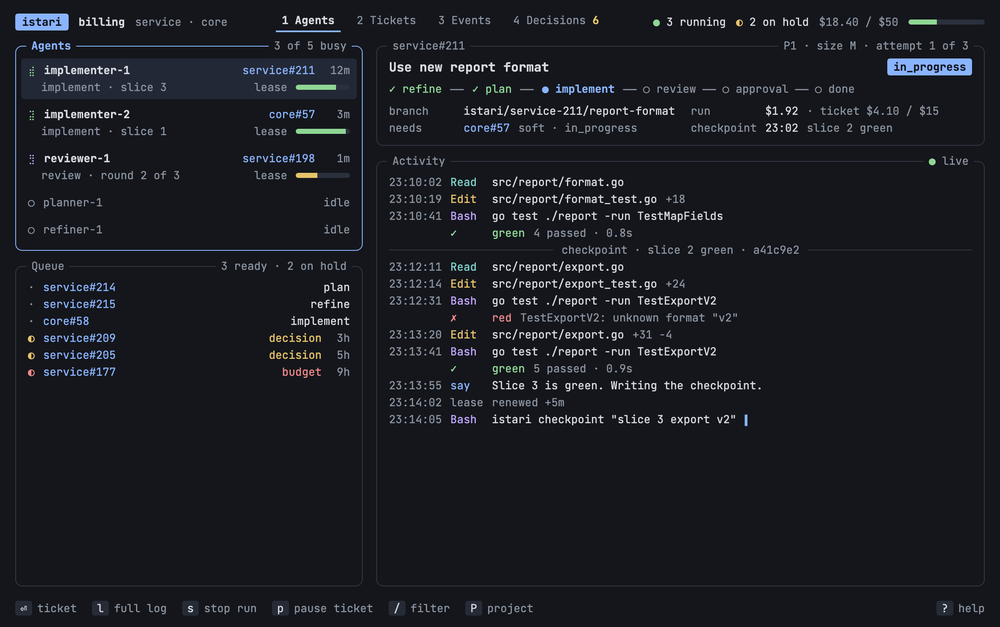
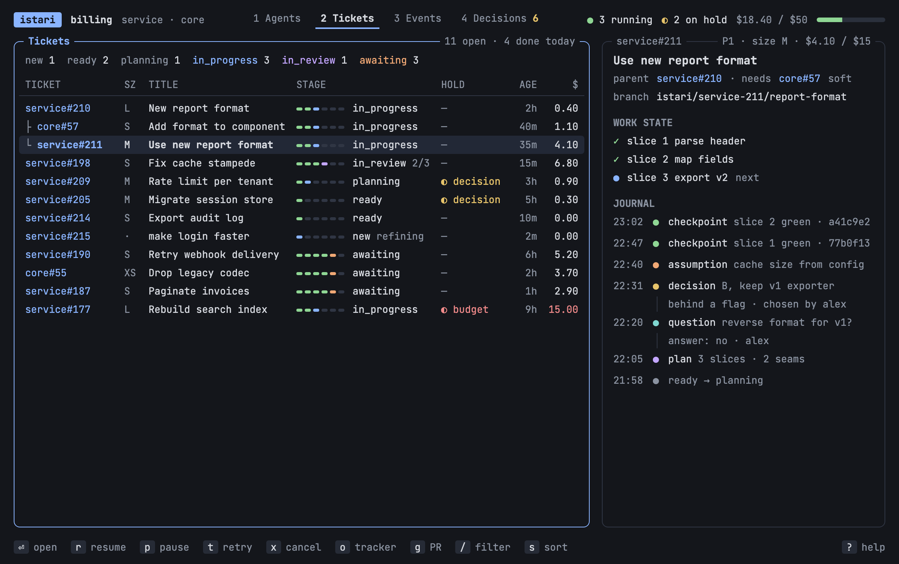

# istari: технический и архитектурный дизайн

Статус: черновик v0.7 · 2026-11-23

istari — self-hosted система управления SDLC для агентов. Она превращает тикет в смерженный PR, проводя его через фиксированный конвейер стадий, которые исполняют агенты под контролем людей.

Требования, от которых отталкивается дизайн:

1. Работа ведётся только через тикеты: нет тикета — нет работ. Трекер подключаемый, по умолчанию GitHub Issues.
2. Тикет может создать кто угодно и как угодно. Перед началом работы istari проверяет его на соответствие стандарту и при необходимости приводит к нужному виду.
3. Создание тикетов отделено от работы над ними. Агента-оркестратора нет: задачи распределяет сам istari, агенты забирают их из очереди.
4. Slack — только канал общения, в том числе между агентами. Всё, что из общения следует (решения, вопросы и ответы, допущения), записывается в тикет.
5. Работу над тикетом можно возобновить в любой момент после любого сбоя: всё нужное для этого лежит в тикете, ветке и PR.
6. Управление — через CLI, мониторинг — через TUI.
7. Проект — это один репозиторий или несколько, из которых собирается один сервис.
8. У каждого тикета своё рабочее дерево (git worktree). После одобрения и слияния PR оно удаляется.
9. Слияние PR настраивается в конфиге, включая режим авто-слияния.
10. Тикеты оцениваются только в размерах T-shirt.
11. TUI поддерживает темы оформления.
12. У тикетов есть приоритет. Связи и пересечения между тикетами отслеживает сам istari (раздел 4.9).
13. Меньше модели, больше детерминированного кода: модель делает только то, что требует суждения, а её результат принимается кодом (раздел 7.7).

---

## 1. Что берём у Vercel Board, а что делаем иначе

Vercel Board (анонс от 18.11.2026) — это «headless communication primitive and message store» для агентов: каналы, треды, метки, задачи с арендой, единый лог событий, гранты, двусторонняя синхронизация со Slack. Это примитив общего назначения, а не SDLC-система: конвейер разработки, гейты и merge в нём не описаны и остаются на стороне пользователя.

| Идея Board | Решение в istari |
|---|---|
| Воркеры сами забирают задачи из очереди (`claim`), никто не назначает задачу конкретному исполнителю | Берём. Воркер — это слот Runner: он забирает готовую задачу нужной роли и запускает под неё харнесс, как `tasks run --ready … -- your-agent` в Board |
| Роль Lead из руководства по swarm: агент, который планирует и раздаёт работу | **Не берём.** Задачи распределяет демон обычным кодом, а качество входа обеспечивает проверка тикета на стандарт |
| Аренда (lease) с продлением; опоздавший получает `claim_lost` | Берём без изменений. Это основа устойчивости к падениям агентов |
| Зависимости `needs`, состояния `waiting → ready` | Берём. Стадии конвейера — это задачи в DAG |
| Один упорядоченный лог событий на board, непрозрачные курсоры, `tail`/`wait` | Берём. Лог — единственный источник для TUI, Slack-синка и аудита |
| Профили акторов («fx via ada»), гранты по путям | Берём в упрощённом виде: роль + область (репозиторий) |
| Учётные данные вне песочницы, доступ через сетевую политику | Берём принцип: в окружении агента только короткоживущий токен запуска |
| Харнесс-агностичность через CLI + skill | Берём. Агент общается с istari через тот же CLI |
| Тред — первичная сущность, задача — надстройка над тредом | **Меняем.** Первичная сущность — тикет во внешнем трекере. Тред в Slack и задачи производны от него |
| Синк GitHub только на вход | **Меняем.** Трекер — источник истины, пишем в него статус и ссылки |
| Нет конвейера, гейтов и merge | **Добавляем.** Это и есть предмет istari |
| Serverless-вотчеры на Vercel | **Меняем.** Один долгоживущий демон, self-hosted |
| Неудачные задачи не перезапускаются, лимит попыток не описан | **Добавляем.** Лимит попыток и бюджеты на тикет |

---

## 2. Модель предметной области

```
Project ──< Ticket ──< Task ──< Run ──< Event
              │          │
              │          └── needs (DAG между задачами)
              └── SlackThread (1:1)
```

| Сущность | Где живёт | Описание |
|---|---|---|
| **Project** | istari | Один или несколько репозиториев одного сервиса + трекер + Slack-канал |
| **Ticket** | внешний трекер (истина), зеркало в istari | Единица работы. Принадлежит ровно одному репозиторию. Идентификатор вида `gh:owner/repo#123` |
| **Task** | istari | Одна стадия конвейера для одного тикета. Имеет роль, состояние, аренду, `needs` |
| **Run** | istari | Одна попытка исполнить задачу одним агентом. Процесс харнесса + рабочее дерево + транскрипт |
| **Event** | istari | Неизменяемая запись в логе. Всё остальное — проекции лога |
| **Actor** | istari | Человек (Slack ID + логин трекера) или профиль агента (`implementer-2`) |
| **Gate** | istari | Точка, где конвейер ждёт решения человека |

Разделение ответственности: тикет, ветка и PR хранят всё, что нужно для работы; istari хранит только то, кто сейчас что исполняет. Slack, сеансы харнессов, рабочие окружения и сама база istari считаются расходными: при их потере работа возобновляется из тикета (раздел 4.6).

### 2.1 Инвариант «нет тикета — нет работ»

Инвариант закреплён на пяти уровнях, чтобы его нельзя было обойти ни одним интерфейсом:

1. **Схема БД.** `task.ticket_id` и `run.task_id` — `NOT NULL` с внешним ключом. Запуск без тикета невозможно даже записать.
2. **API.** В API нет операции «запустить агента с произвольным промптом». Рабочий агент запускается только как исполнитель задачи тикета.
3. **Стандарт тикета.** Создать тикет может кто угодно: человек в трекере, агент в любом харнессе, сообщение в Slack. Но в работу попадает только тикет, прошедший проверку на стандарт и допуск (раздел 4.5).
4. **Git.** Ветка называется `istari/<ticket-key>/<slug>`, каждый коммит несёт трейлер `Ticket: gh:owner/repo#123`. Токен запуска даёт право пушить только в ветки с этим префиксом.
5. **CI.** Обязательная проверка `istari/ticket-link` отклоняет PR без ссылки на открытый тикет. Это закрывает путь в обход istari.

Агентов, работающих вне тикета, нет. Даже приведение тикета к стандарту — это задача самого этого тикета.

---

## 3. Архитектура

```
        Slack                    GitHub / Linear / Jira
          │ Socket Mode                 │ webhooks + REST
┌─────────┴─────────────────────────────┴──────────────┐
│                      istarid                         │
│                                                      │
│  Slack Gateway    Ticket Sync      VCS Adapter       │
│        │               │                │            │
│        └───────┬───────┴────────┬───────┘            │
│                ▼                ▼                    │
│        ┌──────────────────────────────┐              │
│        │   Core: Event Log + Tasks    │◄── Scheduler │
│        │   (SQLite, WAL)              │    (аренды,  │
│        └──────────────┬───────────────┘    таймеры)  │
│                       │                              │
│   Pipeline Engine ◄───┤───► Policy (гранты, бюджеты) │
│                       │                              │
│                 API: gRPC/HTTP + SSE                 │
└──────┬────────────────┬──────────────────┬───────────┘
       │ unix socket    │                  │
   istari CLI      istari top (TUI)    Runner(ы)
                                           │
                                  ┌────────┴────────┐
                                  │ Workspace       │
                                  │ git worktree /  │
                                  │ контейнер       │
                                  │  └ harness      │
                                  │     └ istari CLI│
                                  └─────────────────┘
```

Один бинарник `istari` содержит демон (`istari daemon`), CLI и TUI. Runner в первой версии встроен в демон; позже выносится в отдельный процесс для запуска на других машинах.

**Единица работы — проект.** `istari init` в репозитории создаёт проект: свой Slack-канал, свои тикеты и бюджет. По умолчанию проект — это один репозиторий. Если сервис собирается из нескольких репозиториев, они добавляются в тот же проект командой `istari repo add` (раздел 4.4). У каждого репозитория остаётся свой конвейер (`.istari/pipeline.toml`). Проекты друг друга не видят.

**Демон — один на машину.** Он обслуживает все зарегистрированные репозитории. Отдельный демон на каждый репозиторий не подходит по трём причинам:

- Slack в Socket Mode отдаёт каждое событие только одному из соединений приложения. Несколько демонов с одним Slack-приложением теряли бы чужие события, а отдельное приложение на каждый репозиторий — лишняя настройка.
- Лимит параллельных запусков и дневной бюджет имеют смысл на машину, а не на репозиторий.
- Один TUI показывает агентов всех репозиториев с переключением между ними.

### 3.1 Компоненты

**Core.** Журнал событий и проекции (тикеты, задачи, запуски). Все изменения состояния идут через одну функцию `Append(event)` в транзакции с обновлением проекций. Захват задачи — условный `UPDATE ... WHERE state='ready'`, поэтому из двух одновременных `claim` выигрывает ровно один.

**Pipeline Engine.** При переходе тикета в `ready` разворачивает шаблон конвейера в набор задач с `needs`. Реагирует на завершение задач: открывает следующие, создаёт гейты, возвращает на доработку.

**Scheduler.** Истечение аренд, отложенные проверки («посмотреть CI через 5 минут»), таймауты гейтов, лимиты параллелизма.

**Ticket Sync.** Адаптер трекера: вебхуки на вход, запись меток, комментариев и статуса на выход. Плюс периодическая сверка на случай пропущенного вебхука.

**Slack Gateway.** Socket Mode: исходящее WebSocket-соединение, публичный URL не нужен. Проецирует события в треды и превращает сообщения, кнопки и slash-команды в команды Core.

**VCS Adapter.** Ветки, PR, статусы CI, ревью, merge. По умолчанию — GitHub App с короткоживущими installation-токенами.

**Runner.** Забирает задачи, готовит рабочее окружение, запускает харнесс, продлевает аренду, стримит транскрипт в Core.

**Policy.** Проверяет, кто что может: роли людей, права профилей агентов, бюджеты.

### 3.2 Стек

Решение — **Go**:

- один статический бинарник для демона, CLI и TUI, простая установка;
- Bubble Tea + Lip Gloss для TUI, Cobra для CLI;
- SQLite в режиме WAL (`modernc.org/sqlite`, без cgo) с интерфейсом хранилища, под который позже ложится Postgres;
- харнессы запускаются как подпроцессы, поэтому привязки к SDK конкретного вендора нет.

Агента можно запускать двумя способами. Первый — как внешнюю программу: istari стартует готовый харнесс (t3code, Claude Code, Codex) отдельным процессом и общается с ним через его ввод-вывод. Второй — как библиотеку: агентный SDK подключается в код istari, и цикл агента исполняется внутри процесса демона. Это и есть «встраивание SDK в процесс». Оно даёт более тонкий контроль над каждым шагом агента, но привязывает к языку SDK (обычно TypeScript или Python) и к конкретному вендору.

Требование «любой харнесс и любой провайдер» выполняется только первым способом, поэтому istari работает с харнессами как с внешними программами, и язык самого istari от них не зависит.

---

## 4. Жизненный цикл

### 4.1 Состояния тикета

Тикет — конечный автомат с восемью состояниями и независимым флагом удержания.

```
new ──► ready ──► planning ──► in_progress ──► in_review ──► awaiting_approval ──► done
                                    ▲               │                 │
                                    └───────────────┴─────────────────┘
                                           возврат на доработку

любое незавершённое состояние ──► canceled ──► new (reopen)
```

| Состояние | Смысл | Кто работает |
|---|---|---|
| `new` | Тикет создан и проверяется на стандарт; при необходимости приводится к нему | refiner, при вопросах — автор |
| `ready` | Тикет соответствует стандарту и допущен к работе, ждёт свободного исполнителя | — |
| `planning` | Составляется технический план | planner |
| `in_progress` | Пишется код, идёт CI | implementer |
| `in_review` | PR проверяет агент | reviewer |
| `awaiting_approval` | PR ждёт ревью человека и merge | человек |
| `done` | PR смержен, тикет закрыт. Конечное состояние | — |
| `canceled` | Работа прекращена | — |

**Переходы.** Других переходов нет; попытка выполнить переход вне таблицы отклоняется.

| # | Из | Событие | В | Кто инициирует | Условие |
|---|---|---|---|---|---|
| T1 | — | `create` | `new` | кто угодно: человек, агент, сообщение в Slack | — |
| T2 | `new` | `accept` | `ready` | система | тикет соответствует стандарту и допущен (раздел 4.5) |
| T3 | `ready` | `start` | `planning` | система | есть свободный слот, нет удержания, тикеты из `needs` завершены; среди готовых берётся тикет с высшим приоритетом |
| T4 | `planning` | `plan_accepted` | `in_progress` | система; человек, если включён гейт плана | план опубликован в тикете; зона изменений не пересекается с тикетами в работе, иначе удержание `waiting_zone` |
| T5 | `planning` | `split` | `in_progress` | planner | созданы дочерние тикеты; собственных задач у родителя нет. Обязателен, если размер тикета больше `max_size` |
| T6 | `in_progress` | `pr_ready` | `in_review` | система | PR открыт, CI зелёный |
| T7 | `in_review` | `changes_requested` | `in_progress` | система, по находкам reviewer | в принятом отчёте reviewer есть находки; раундов меньше `max_review_rounds`, иначе удержание |
| T8 | `in_review` | `review_passed` | `awaiting_approval` | система, по находкам reviewer | в принятом отчёте reviewer находок нет; CI зелёный |
| T9 | `awaiting_approval` | `changes_requested` | `in_progress` | человек через GitHub review | — |
| T10 | `awaiting_approval` | `merge_failed` | `in_progress` | система | конфликт или красный CI после обновления ветки |
| T11 | `awaiting_approval` | `merged` | `done` | система или человек, по режиму слияния (раздел 4.8) | обязательные проверки пройдены; одобрение человека, если режим его требует |
| T12 | `in_progress` | `children_done` | `done` | система | у тикета есть дочерние, и все они в `done` |
| T13 | любое, кроме `done` и `canceled` | `cancel` | `canceled` | человек | запуски остановлены, PR закрыт |
| T14 | `canceled` | `reopen` | `new` | человек | — |
| T15 | `ready` | `edited` | `new` | система | изменён текст обязательных разделов тикета (сравнение по хешу); правка меток и опечаток вне этих разделов проверку не запускает |

`done` не переоткрывается: регрессия оформляется новым тикетом со ссылкой на исходный.

**Удержание (`hold`).** Это не состояние, а флаг поверх любого незавершённого состояния. Пока он стоит, задачи тикета не выдаются исполнителям, а состояние не меняется. После снятия тикет продолжает с того же места, поэтому на доске видно, на какой стадии он застрял.

| Причина | Когда ставится | Кто снимает |
|---|---|---|
| `needs_input` | агент задал вопрос и остановился | человек — ответом в треде |
| `attempts_exhausted` | задача провалилась `max_attempts` раз либо исчерпаны раунды ревью | человек — командой `retry` |
| `budget_exceeded` | превышен бюджет тикета | человек — повышением бюджета |
| `paused` | человек поставил тикет на паузу | человек — командой `resume` |
| `waiting_dependency` | в ходе работы выяснилось, что нужен ещё не завершённый тикет, обычно в соседнем репозитории | система — когда тикет-зависимость завершён |
| `waiting_zone` | зона изменений тикета пересекается с зоной другого тикета, который уже в работе | система — когда тот тикет слит или отменён |

**Правила автомата.**

- Переходы выполняет только Core. Каждый переход — событие `ticket.transitioned` с полями `from`, `to`, `trigger`, `actor`, поэтому история тикета полностью восстанавливается из лога.
- Состояние тикета меняется только событиями из таблицы. Состояния задач (раздел 4.2) — более мелкий уровень внутри одного состояния тикета.
- В GitHub Issues состояние хранится ровно одной меткой `istari:<state>`, удержание — меткой `istari:hold:<reason>`. `done` закрывает issue как completed, `canceled` — как not planned. В Linear и Jira используются нативные статусы по таблице соответствия из конфига адаптера.
- Ручная правка метки в трекере считается запросом на переход. Если переход допустим и автор имеет на него право, он применяется; иначе istari возвращает метку и объясняет причину в комментарии.

### 4.2 Состояния задачи

Как в Board, плюс лимит попыток:

```
waiting ──(все needs завершены)──► ready ──claim──► claimed
                                     ▲                │
              release / аренда истекла               ├─ complete ─► completed
                                     │                ├─ fail ─────► failed ──(attempt < max)──► ready
                                     └── unblock ◄── blocked ◄─ block
canceled — из любого открытого состояния
```

- Аренда по умолчанию 5 минут, Runner продлевает на трети срока.
- После истечения задача возвращается в `ready`, событие `task.expired`. Любое действие старого владельца отклоняется с `claim_lost`.
- `max_attempts` по умолчанию 3. После исчерпания тикет получает удержание `attempts_exhausted`, и istari сообщает об этом в Slack.
- `block --kind` различает причины: `needs_input`, `awaiting_approval`, `budget_exceeded`, `ci_red`.

### 4.3 Конвейер по умолчанию

| # | Стадия | Исполнитель | Состояние тикета | Результат | Гейт |
|---|---|---|---|---|---|
| 0 | refine | refiner | `new` | тикет, приведённый к стандарту | проверка и допуск (раздел 4.5) |
| 1 | plan | planner | `planning` | план в комментарии тикета, включая швы для тестов (раздел 7.6) | одобрение плана: по умолчанию выключено, включается в конфиге (`plan_gate`) |
| 2 | implement | implementer | `in_progress` | ветка, коммиты, draft PR | — |
| 3 | verify | (без агента) | `in_progress` | статус CI | CI зелёный |
| 4 | review | reviewer | `in_review` | ревью с замечаниями или одобрение | — |
| 5 | approve | человек; в режиме `auto` пропускается | `awaiting_approval` | GitHub review | по режиму слияния (раздел 4.8) |
| 6 | merge | (без агента) | `awaiting_approval` → `done` | merge, закрытие тикета, удаление рабочего дерева | — |

Правила:

- Reviewer и implementer — всегда разные профили, по возможности разные модели. Агент не ревьюит собственный код.
- Замечания ревью или красный CI создают новую задачу `implement` с `needs` на исходную, счётчик итераций ограничен (`max_review_rounds`, по умолчанию 3).
- Когда слияние требует человека, одобрением служит GitHub review от участника из CODEOWNERS, а не кнопка в Slack. Кнопка в Slack годится для обратимых гейтов (одобрить план, разблокировать). Режимы слияния описаны в разделе 4.8.
- Конвейер задаётся декларативно в `.istari/pipeline.toml` репозитория; стадии можно убирать, добавлять и делать параллельными.

Если тикет слишком велик, planner разбивает его на дочерние тикеты (sub-issues). Каждый из них проходит проверку на стандарт и свой конвейер. Родитель остаётся в `in_progress` и переходит в `done`, когда завершены все дочерние (T5, T12).

### 4.4 Работа на несколько репозиториев

Типичный случай: сервис живёт в одном репозитории, а один из его компонентов вынесен в другой. Оба репозитория входят в один проект: у них общий Slack-канал, общий бюджет и зависимости между тикетами.

**Тикеты.** Тикет всегда принадлежит одному репозиторию: issue, ветка и PR живут в нём, правило «один тикет — один PR» сохраняется. Задача, затрагивающая оба репозитория, оформляется так (вручную или planner при разбиении):

```
gh:acme/service#210  «Поддержать новый формат отчёта»      родитель, основной репозиторий
 ├─ gh:acme/component#57  «Добавить формат в компонент»     дочерний
 └─ gh:acme/service#211   «Использовать новый формат»       дочерний, needs: component#57
```

**Порядок.** Зависимость между дочерними тикетами задаётся через `needs` и бывает двух видов:

| Вид | Поведение | Когда использовать |
|---|---|---|
| `hard` (по умолчанию) | Зависимый тикет стартует (T3) только после завершения зависимости. В его бриф попадает её результат: коммит или версия | Сервис потребляет компонент как опубликованную версию |
| `soft` | Оба тикета идут параллельно, сервис собирается против ветки компонента. Merge сервиса (T11) дополнительно ждёт завершения зависимости | Контракт согласован заранее, нужна скорость |

**Что считается завершением компонента.** Настраивается для репозитория: `done_when = "merged"` или `"released"`. Во втором случае тикет компонента переходит в `done` только после публикации релиза, и зависимый тикет получает номер версии.

Значение подбирается автоматически. При `istari repo add` istari смотрит, как репозитории связаны, и предлагает настройку, которую человек подтверждает:

| Что найдено | Способ связи | `done_when` | Сборка в режиме `soft` |
|---|---|---|---|
| зависимость с номером версии в манифесте (`go.mod`, `package.json`, `pyproject.toml` и подобные) | опубликованный пакет | `released` | временная подмена версии на ветку компонента; перед merge возвращается версия релиза |
| запись в `.gitmodules` | git-подмодуль | `merged` | подмодуль указывает на ветку компонента; перед merge — на коммит из основной ветки |
| ссылка на соседний каталог (`replace`, `file:`, `path =`) | локальный путь | `merged` | соседний репозиторий подключается на ветке компонента |
| ничего из перечисленного | связь не определена | `merged` | режим `soft` недоступен, пока человек не опишет связь |

**Рабочее окружение.** Агент пишет только в репозиторий своего тикета. Остальные репозитории проекта подключаются к окружению только для чтения, чтобы он видел контракт и реальное использование.

**Зависимость, обнаруженная по ходу работы.** Если исполнитель в сервисе выясняет, что нужна правка компонента, сам он её не делает. Он создаёт тикет в репозитории компонента и ставит свой тикет на удержание `waiting_dependency`. Новый тикет проходит проверку на стандарт и наследует допуск. Когда компонент готов, удержание снимается автоматически.

**Slack.** Рабочий канал и канал решений у проекта общие для всех репозиториев (раздел 6). Родительский тикет и каждый дочерний имеют свои треды; в карточке указан репозиторий и ссылки на связанные тикеты.

### 4.5 Стандарт тикета

Создание тикета и работа над ним разделены. Для istari неважно, кто и как создал тикет: человек в трекере, агент в сеансе `claude` после совместной работы над спецификацией, сообщение в Slack или другой агент по ходу своей задачи. Важно одно: в работу попадает только тикет, соответствующий стандарту.

**Что такое стандарт.** Два файла в репозитории, которые проект может менять: `.istari/ticket-standard.toml` — схема, которую проверяет код, и `.istari/ticket-standard.md` — требования к качеству для refiner.

| Часть | Что проверяется | Кем |
|---|---|---|
| Структура | обязательные разделы («Контекст», «Что нужно сделать», «Критерии приёмки», «Вне рамок»), тип тикета, размер T-shirt, приоритет, репозиторий, ссылки на зависимости; граф зависимостей без циклов и ссылок на несуществующие тикеты; упомянутые пути к файлам существуют в репозитории | кодом |
| Качество | критерии приёмки проверяемы; нет противоречий и двусмысленностей; размер соответствует объёму и не превышает допустимый; упомянутые модули и API существуют в коде; тикет не дублирует и не противоречит тикетам из списка кандидатов, отобранного кодом | агентом refiner |

**Проверка и приведение к стандарту.** Выполняется для каждого тикета в `new`:

1. Структурная проверка кодом. Недостающий приоритет код заполняет значением по умолчанию.
2. Код отбирает кандидатов в дубли: открытые и недавно завершённые тикеты с совпадающими путями, идентификаторами и ключевыми словами.
3. Refiner читает тикет, код и список кандидатов и оценивает качество. Результат он сдаёт структурированно: вердикт, размер, список отклонений, список допущений.
4. Тикет соответствует стандарту — он переходит к допуску.
5. Тикет не соответствует, но недостающее выводится из его текста и кода — refiner переписывает тикет в стандартный вид. Исходный текст сохраняется в свёрнутом блоке в конце тикета, а в комментарии перечислено, что изменено и какие допущения сделаны. Код проверяет, что исходный текст сохранён дословно, и повторяет структурную проверку.
6. Не хватает сведений, которые вывести нельзя, — refiner задаёт вопросы автору в комментарии тикета и в канале решений и ставит удержание `needs_input`. После ответа проверка повторяется.

Refiner не меняет смысл тикета и не добавляет требований, которых автор не просил. Всё, что он додумал, помечено как допущение.

**Допуск.** Соответствие стандарту ещё не разрешение работать: иначе агентов запускал бы любой, кто может создать issue. Для перехода T2 нужно одно из условий:

- автор тикета — доверенный участник проекта;
- тикет создан агентом в ходе работы над уже допущенным тикетом; он наследует допуск и бюджет родителя;
- доверенный участник допустил тикет вручную: меткой `istari:ready`, командой `/istari ready` или `istari ticket ready`.

**Изменение после допуска.** Правка тикета в `ready` запускает проверку заново (T15). Правка на более поздних стадиях состояние не меняет: исполнитель получает её сообщением в треде.

**Проверка заранее.** `istari ticket check` показывает отклонения от стандарта, ничего не меняя. Агент, с которым человек пишет спецификацию, может вызвать её до создания тикета.

### 4.6 Тикет как журнал и возобновление работы

Работа над тикетом может прерваться в любой момент и по любой причине. Продолжить её должен суметь другой агент, в другом харнессе, на другой машине и через любое время. Поэтому всё нужное для продолжения хранится в трёх долговечных местах, а остальное считается расходным.

| Долговечное | Что хранит |
|---|---|
| Тикет | требования, решения, вопросы и ответы, допущения, план, контрольные точки, состояние |
| Ветка | код, включая незавершённый |
| PR | ревью и замечания к коду |

| Расходное | Что происходит при потере |
|---|---|
| Slack | пропадает переписка; решения и ответы уже записаны в тикет |
| Сеанс харнесса и его контекст | новый запуск начинает с тикета и ветки |
| Рабочее окружение | пересоздаётся из ветки |
| База istari | восстанавливается из трекера командой `istari recover` |

**Журнал тикета.** Это комментарии установленного вида в самом тикете. Их пишет istari по командам агентов и по событиям в Slack.

| Запись | Когда появляется | Кто создаёт |
|---|---|---|
| Вопрос и ответ | агент спросил, человек ответил | агент — `istari ask`; ответ istari записывает дословно, с автором и ссылкой на сообщение |
| Решение | нужен выбор между вариантами | агент готовит карточку решения, человек выбирает вариант; либо человек сам — реакцией 📌 на сообщении или `/istari decide` |
| Допущение | агент решил сам в режиме `decide` | агент — `istari assume` |
| План | завершена стадия plan | planner |
| Контрольная точка | завершён осмысленный шаг работы | implementer — `istari checkpoint`: что сделано и что дальше. Коммит, результаты проверок и список изменённых файлов добавляет код |
| Итог ревью | завершена стадия review | reviewer; подробности остаются в PR |
| Переход | изменилось состояние или удержание | istari |

Решение, которое меняет требования, вносится ещё и в текст тикета. Текст всегда описывает актуальное задание, а журнал объясняет, как к нему пришли.

**Карточка решения.** Свободное обсуждение в треде само в тикет не попадает: модель могла бы записать как решение то, о чём люди не договорились. Вместо этого агент готовит карточку решения, а человек выбирает.

Карточка имеет обязательную схему:

| Раздел | Содержание |
|---|---|
| Проблема | что нужно решить и почему это блокирует работу или влияет на результат |
| Текущее состояние | как обстоят дела сейчас: что есть в коде и в тикете, какие ограничения, что уже прозвучало в обсуждении |
| Варианты A, B, C… | не меньше двух. Для каждого: суть, последствия, размер T-shirt, риски, что придётся менять |
| Рекомендация | какой вариант агент советует и почему: аргументы, пояснения, при каких условиях он выбрал бы другой |

Агент передаёт карточку как структурированные данные (`istari decide --propose --file card.yaml`). istari проверяет её по схеме и отклоняет неполную: без описания текущего состояния, с одним вариантом или без аргументации рекомендации.

**Как принимается решение.**

1. Агент готовит карточку, когда обсуждение пришло к развилке или когда ему самому нужен выбор между вариантами. Вопрос вида «как поступить» всегда оформляется карточкой; `istari ask` остаётся для фактических вопросов.
2. Карточка сначала сохраняется в тикете как предложенная, затем публикуется в канале решений проекта с кнопками: «A», «B», «C» (по одной на вариант, рекомендованный помечен), «Предложить опцию» и «Отложить».
3. Кнопка варианта принимает его; к выбору можно добавить комментарий.
4. «Предложить опцию» открывает форму, где человек описывает свой вариант. Агент добавляет его в карточку следующей буквой, оценивает по тем же пунктам, что и остальные, при необходимости меняет рекомендацию и публикует обновлённую карточку. Решение принимается выбором в обновлённой карточке.
5. «Отложить» оставляет карточку открытой. Тикет, которому нужно это решение, остаётся на удержании, агенты переходят к другим тикетам. Отложенная карточка каждый день появляется в утреннем отчёте, пока по ней не сделан выбор. Ошибочную карточку закрывает команда `/istari decide --dismiss`.
6. В тикет записывается решение: карточка целиком, выбранный вариант, кто выбрал, комментарий. Отклонённые варианты остаются в записи, чтобы позже было видно, что рассматривалось и почему отвергнуто.
7. Пока выбор не сделан, агент на карточку не опирается. Если от решения зависит работа, тикет остаётся на удержании `needs_input`.
8. Выбирать может только участник проекта со связанной учётной записью. Выбрать можно и в трекере, комментарием к карточке.

Если агент в обсуждении не участвует (в треде разговаривают только люди), карточку можно запросить реакцией 📝 на треде или командой `/istari decide --propose`. Её готовит refiner как задачу этого тикета.

Напрямую, без подтверждения, агент записывает только допущения (`istari assume`): они помечены как его собственные и видны при ревью.

**Сводка.** В теле тикета istari ведёт блок «Состояние работы»: стадия, ветка, PR, последняя контрольная точка, открытые вопросы, следующий шаг. Блок собирает код из полей записей журнала, без пересказа моделью, и обновляет при каждой записи. Человек по нему за минуту понимает, где тикет; агент с него начинает.

**Правила.**

- Вопрос сначала записывается в тикет, затем публикуется в Slack. Ответить можно в треде вопроса в Slack или комментарием в тикете.
- Удержание `needs_input` снимается только после того, как ответ записан в тикет.
- Агент получает бриф только из долговечных источников. Обсуждение в Slack, не записанное в тикет, для агентов не существует.
- Контрольная точка — это коммит, push в ветку тикета и запись в журнал. Незавершённая работа пушится как есть: ветка тикета рабочая. При сбое теряется только сделанное после последней контрольной точки.
- Продолжение сеанса харнесса — ускорение, а не необходимость. Ни одна стадия на него не опирается.

**Возобновление.** Упал агент, истекла аренда, перезагрузилась машина, тикет месяц простоял на паузе, потеряна база istari — последовательность одна:

1. istari читает из трекера состояние тикета и сводку.
2. Создаёт рабочее окружение из ветки тикета и подтягивает в неё основную ветку. Конфликты становятся первым шагом исполнителя.
3. Собирает бриф из текста тикета, журнала и PR по шаблону. Если журнал длинный, код берёт все решения и допущения, последний план и последние контрольные точки; модель для сжатия журнала не используется.
4. Новый запуск продолжает со следующего шага последней контрольной точки.

При истечении аренды это происходит автоматически. Вручную — `istari ticket resume` для любого незавершённого тикета.

### 4.7 Оценка размера

Тикеты оцениваются только в размерах T-shirt. Часов, дней и story points в istari нет: ни в тикетах, ни в карточках решений, ни в отчётах.

| Размер | Объём |
|---|---|
| `XS` | правка в одном месте: конфиг, текст, одна функция. Один срез |
| `S` | один модуль, один-два среза, один шов |
| `M` | несколько срезов в одном модуле или два связанных модуля |
| `L` | несколько модулей, новый интерфейс между ними, много срезов |
| `XL` | больше одного PR. В работу не идёт: тикет разбивается |

**Кто оценивает.** Размер ставит refiner при проверке тикета; это обязательное поле стандарта. Если автор указал размер сам, refiner его проверяет и при расхождении исправляет с пояснением в комментарии. Planner может изменить оценку после изучения кода; implementer — сообщить, что размер оказался больше. Каждое изменение записывается в журнал тикета.

**Где хранится.** В трекере — метка `size:M`. В GitHub Issues это метка, в Linear и Jira — поле оценки, настроенное на шкалу T-shirt.

**На что влияет размер.**

- **Бюджет.** Предел расходов на тикет берётся из таблицы `budget_usd` по размеру.
- **Разбиение.** Тикет крупнее `max_size` (по умолчанию `L`) planner обязан разбить на дочерние (T5). `XL` не исполняется никогда.
- **Авто-слияние.** В режиме `auto` без человека сливаются только тикеты не крупнее `auto_max_size` (раздел 4.8).
- **Карточки решений.** Цена каждого варианта указывается размером, а не временем.

### 4.8 Слияние PR

Режим слияния задаётся в конфиге (`[defaults.merge]`, переопределяется в `.istari/pipeline.toml` репозитория).

| Режим | Кто одобряет | Кто сливает | Когда тикет переходит в `done` |
|---|---|---|---|
| `manual` | человек | человек | когда istari видит, что PR слит |
| `after_approval` (по умолчанию) | человек, GitHub review | istari, сразу после одобрения | после слияния |
| `auto` | никто: достаточно пройденного ревью агента и зелёного CI | istari | после слияния |

**Ограничения режима `auto`.** Без человека сливается только PR, для которого выполнено всё сразу:

- размер тикета не больше `auto_max_size` (по умолчанию `S`);
- reviewer не оставил находок, CI зелёный;
- изменение не затрагивает пути из списка `irreversible_paths` в конфиге (миграции, схемы данных, публичные интерфейсы, инфраструктура). Это проверяет код по diff; раздел Merge Danger, написанный агентом, может только ужесточить вывод, но не смягчить;
- число изменённых строк и файлов укладывается в пределы для размера тикета;
- в ходе работы агенты не записали допущений, ожидающих проверки человеком.

PR, не прошедший хотя бы одно условие, ждёт человека как в режиме `after_approval`. Причина указывается в карточке тикета в Slack и на вкладке Decisions.

**После слияния** в любом режиме: тикет закрывается, ветка удаляется, рабочее дерево удаляется (раздел 7.2), зависимые тикеты получают сигнал о готовности.

**Способ слияния** задаётся параметром `method`: `squash`, `merge` или `rebase`.

### 4.9 Координация тикетов

Задачи никто не назначает, поэтому связями между тикетами, порядком и конфликтами управляют три слоя: автор тикетов, агенты на своих стадиях и планировщик. Отдельного агента-координатора нет.

**Приоритет.** У каждого тикета есть приоритет:

| Приоритет | Смысл |
|---|---|
| `P0` | срочно: берётся первым же освободившимся слотом |
| `P1` | важно |
| `P2` | обычный, по умолчанию |
| `P3` | когда будет время |

- Приоритет ставит человек: автор тикета или участник проекта. Агенты его не меняют. Если автор приоритет не указал, код подставляет значение по умолчанию из конфига.
- В трекере хранится меткой `priority:P1` либо нативным полем приоритета.
- Очередь упорядочена по приоритету, при равном — по возрасту.
- Приоритет наследуется вниз по зависимостям: если `P0` ждёт тикет с `P3`, тот исполняется как `P0`. Иначе срочная работа стояла бы за несрочной.
- Идущую работу приоритет не прерывает: `P0` получает следующий свободный слот.

**Слой 1. Автор задаёт граф.** Связи лучше всего видны тому, кто пишет спецификацию. Набор тикетов из одной спецификации создаётся одним вызовом `istari ticket create --file plan.yaml`: в файле у каждого тикета есть ключ, а связи `needs` ссылаются на ключи соседей или на существующие тикеты. При приёме istari проверяет граф: нет циклов, нет ссылок на несуществующие или отменённые тикеты.

**Слой 2. Агенты на своих стадиях.**

- **Refiner оценивает дубли и противоречия.** Кандидатов отбирает код (раздел 4.5); refiner читает только их. Найденный дубль или противоречие не решается молча: refiner готовит карточку решения с вариантами (объединить, закрыть как дубль, оставить оба и связать через `needs`).
- **Planner объявляет зону изменений.** План сдаётся структурированно (`istari plan submit`): срезы, швы, зона изменений. Код проверяет его по схеме, проверяет, что пути зоны существуют или помечены как новые, и что число файлов в зоне соответствует размеру тикета; при расхождении размер пересматривается.
- **Implementer обнаруживает зависимости по ходу.** Если нужна правка за пределами тикета, он создаёт тикет-зависимость (раздел 4.4).

**Слой 3. Планировщик.** Работает обычным кодом, без модели.

| Механизм | Что делает |
|---|---|
| Зоны изменений | Тикет, чья зона пересекается с зоной тикета в работе, не начинает разработку: он получает удержание `waiting_zone` и стартует, когда первый слит. Кто идёт первым, решают приоритет и возраст |
| Выход за зону | На каждой контрольной точке Runner сравнивает фактические изменения с объявленной зоной. Выход за неё расширяет зону и записывается в журнал. Если расширенная зона задела другой тикет в работе, тикет с меньшим приоритетом останавливается на этой контрольной точке |
| Очередь слияния | PR одного репозитория сливаются по одному: ветка обновляется от основной, CI запускается заново, затем слияние. Неудача возвращает тикет на доработку (T10) |
| Оповещение после слияния | Тикеты в работе, чьи зоны пересекаются с только что слитыми изменениями, получают запись в журнал со списком коммитов и обновляют ветку на ближайшей контрольной точке |
| Свежесть планов | План пишется в момент старта тикета, а не заранее, поэтому устареть может только то, что уже идёт параллельно; этот случай закрывает оповещение |

Поведение при пересечении зон задаётся параметром `zones`: `serialize` (по умолчанию, как описано выше), `warn` (тикеты идут параллельно, пересечение показывается в Slack и TUI) или `off`.

**Что остаётся человеку.** Взгляд на весь набор тикетов: ведут ли они вместе туда, куда нужно, и нет ли связей, не видных ни из одного тикета по отдельности. Для этого служат вкладка Tickets, команда `istari ticket deps` и утренний отчёт, в который попадают тикеты, ждущие из-за пересечения зон. Отдельная роль агента для обзора всего бэклога в первую версию не входит: её стоит добавлять, если на практике таких случаев окажется много.

---

## 5. Тикет-системы

```go
type TicketProvider interface {
    Get(ctx, ref TicketRef) (Ticket, error)
    List(ctx, q Query) ([]Ticket, error)
    Create(ctx, draft TicketDraft) (Ticket, error)
    SetState(ctx, ref TicketRef, s State) error
    Comment(ctx, ref TicketRef, body string) (CommentRef, error)
    Link(ctx, ref TicketRef, l Link) error           // PR, Slack-тред, дочерний тикет
    Subscribe(ctx) (<-chan TicketEvent, error)        // вебхуки или polling
    Capabilities() Caps                               // sub-issues, custom states, webhooks
}
```

- Адаптер компилируется в бинарник и выбирается в конфиге проекта. Первая версия: `github`. Следом `linear`, `jira`.
- Ссылка на тикет всегда с префиксом провайдера (`gh:`, `lin:`, `jira:`), чтобы проекты с разными трекерами жили в одной инсталляции.
- Отображение состояний istari на состояния трекера — в конфиге адаптера. Для GitHub это метки, для Linear и Jira — нативные статусы.
- Echo-подавление: адаптер помечает собственные записи и игнорирует вебхуки о них.
- Тикет-трекер и хостинг кода — независимые адаптеры: тикеты могут быть в Linear, а PR в GitHub.

---

## 6. Slack

**Slack — только канал общения.** В нём задают вопросы, обсуждают и уведомляют. Ничего, что нужно для работы, не хранится только в Slack: результаты общения записываются в тикет (раздел 4.6).

**Каналы.** Их три вида. Разделение нужно, чтобы переписка агентов не заглушала то, что требует человека.

| Канал | Сколько | Назначение | Кто пишет | Кто читает | Уведомления |
|---|---|---|---|---|---|
| `#<project>-agents` — рабочий | один на проект, общий для всех его репозиториев | ход работы: один тред на тикет, в нём общаются агенты | istari (карточки тикетов), агенты (в тредах), люди (реплики в тредах и новые задания) | участники проекта, по желанию | рекомендуется отключить |
| `#<project>-decisions` — решения | один на проект | только то, что ждёт человека, и утренний отчёт | istari; люди отвечают в тредах сообщений | те, кто принимает решения по проекту | включить на все сообщения |
| `#agents-ops` — служебный | один на инсталляцию | сбои самой системы | только istari | тот, кто обслуживает istari | включить |

Имена каналов задаются в конфиге и могут быть любыми: istari не требует ни префикса, ни определённой схемы. Имена в этом документе — пример: каналы одного проекта начинаются с его имени и поэтому стоят рядом в списке.

В Slack работает одно приложение `istari`. Агенты пишут через него под именем своей роли (`implementer-2`, `reviewer-1`), отдельных учётных записей у них нет. Каналы могут быть закрытыми: права на решения всё равно определяются связью учётной записи с проектом, а не членством в канале.

**Что куда попадает.**

| Сообщение | Канал | Вид |
|---|---|---|
| Карточка тикета: стадия, размер, приоритет, PR, CI, расход | рабочий | корневое сообщение треда, обновляется на месте |
| Смена стадии, план, итог ревью, сообщения агентов друг другу | рабочий | реплики в треде тикета |
| Новое задание от человека (`@istari …`) | рабочий | сообщение в канале; из него создаётся тикет и его тред |
| Карточка решения с кнопками | решения | отдельное сообщение; в треде тикета — ссылка на него |
| Фактический вопрос агента | решения | отдельное сообщение; ответ — в его треде |
| PR готов к ревью человека | решения | отдельное сообщение со ссылкой и разделом Merge Danger |
| Удержание, требующее действия: бюджет, исчерпаны попытки | решения | отдельное сообщение с кнопками (поднять бюджет, перезапустить, отменить) |
| Тикет от недоверенного автора ждёт допуска | решения | отдельное сообщение с кнопкой допуска |
| Утренний отчёт | решения | отдельное сообщение |
| Сбой демона или харнесса, потерянная аренда, ошибка синхронизации с трекером, неудалённое рабочее дерево, исчерпан дневной бюджет | служебный | отдельное сообщение |

Правила:

- В канале решений каждое сообщение упоминает того, от кого ждут действия: автора тикета, а если он не участник проекта — ответственного по умолчанию из конфига. Когда действие выполнено, сообщение помечается как закрытое и сворачивается до одной строки.
- Обсуждение карточки решения или вопроса идёт в треде этого сообщения в канале решений. Агент, задавший вопрос, получает реплики оттуда так же, как из треда тикета.
- Контрольные точки и вызовы инструментов в Slack не публикуются: они есть в журнале тикета и в TUI.
- Когда тикет завершён, его карточка в рабочем канале получает итог и ссылку на слитый PR; тред остаётся как архив переписки.
- Вкладка Decisions в TUI показывает то же, что канал решений.

Для маленькой инсталляции канал решений можно не выделять: если в конфиге проекта задан только рабочий канал, такие сообщения идут в него отдельными сообщениями вне тредов.

**Кто и когда это создаёт.**

| Что | Кто | Когда | Как |
|---|---|---|---|
| Приложение Slack | человек, устанавливающий istari; нужно право устанавливать приложения в рабочем пространстве | один раз на инсталляцию | `istari slack setup` |
| Служебный канал | istari | там же, сразу после установки приложения | создаётся автоматически |
| Рабочий канал и канал решений проекта | istari | при `istari init` в репозитории | создаются автоматически либо подключаются существующие |
| Связь учётных записей людей | каждый участник сам | перед первым решением в Slack | `istari user link` |

Приложение создаёт человек: Slack не позволяет программе завести приложение и получить его токены без участия пользователя рабочего пространства. `istari slack setup` сводит это к нескольким шагам:

1. Команда печатает манифест приложения: имя, права, slash-команду `/istari`, включённые Socket Mode и интерактивные элементы.
2. Человек открывает страницу создания приложения в Slack, выбирает «из манифеста», вставляет его и устанавливает приложение в рабочее пространство. Если в пространстве включено согласование приложений, на этом шаге нужно одобрение администратора.
3. Человек копирует два токена, которые выдаёт Slack: токен приложения для Socket Mode и токен бота.
4. Команда принимает токены, проверяет их запросом к Slack, сохраняет в системном хранилище секретов и создаёт служебный канал.

Каналы проекта создаёт сам istari при `istari init`: у приложения есть право создавать каналы и приглашать в них. Он задаёт каналам описание, приглашает ответственного за проект и публикует в рабочем канале короткую справку. Имена берутся из конфига; если канал с таким именем уже есть, istari к нему присоединяется и ничего в нём не меняет. Закрытый канал, созданный человеком, подключается иначе: человек приглашает в него приложение и указывает имя в конфиге.

`istari doctor` проверяет, что токены действуют, приложение состоит во всех каналах из конфига и у него есть нужные права. Точный список прав приложения фиксируется при реализации этапа M4 и проверяется на реальном рабочем пространстве.

**Агент ↔ агент.** Агенты одного тикета не работают одновременно: каждый запуск делает свою стадию и завершается. Поэтому они не переписываются в свободной форме, а передают друг другу структурированные результаты: план, отчёт ревью, контрольные точки. Каждый такой результат код публикует в треде тикета, так что в Slack видна вся координация и скрытого канала нет. Свободные сообщения (`istari post`) остаются для пояснений человеку.

Технически агент вызывает `istari post`, демон публикует сообщение в Slack от имени профиля (`chat:write.customize`: имя и аватар роли) и только после успешной публикации доставляет его адресату. Копия в логе событий нужна для доставки, TUI и аудита. Если Slack недоступен, сообщения ждут в очереди отправки.

**Что не попадает в Slack.** Транскрипт запуска: вызовы инструментов, вывод команд, промежуточные рассуждения. Он остаётся в istari и виден в TUI.

**Человек → агент.**

| Действие | Результат |
|---|---|
| Ответ в треде вопроса в канале решений или в треде тикета | вопрос и ответ записываются в тикет; удержание `needs_input` снимается; агент продолжает |
| `@istari <задание>` в канале | из сообщения создаётся тикет в `new`; дальше он проходит проверку на стандарт, как любой другой |
| Кнопки на карточке | Approve plan · Pause · Retry · Cancel |
| `/istari status [ticket]` | сводка эфемерным сообщением |
| `/istari ready <ticket>` | допустить тикет к работе (нужна роль approver) |
| Реакция 🛑 на корневом сообщении | немедленная остановка запусков по тикету |
| Реакция 📌 на сообщении в треде | сообщение записывается в тикет как решение |
| Кнопки под карточкой решения | A · B · C · Предложить опцию · Отложить |
| Реакция 📝 на треде | агент готовит карточку решения по обсуждению |

**Утренний отчёт.** В заданное в конфиге время istari публикует в канале решений отчёт: какие PR ждут ревью, какие тикеты на удержании и почему, какие карточки решений ждут выбора, какие допущения приняли агенты, сколько потрачено. Отчёт собирается из лога событий кодом, без участия модели.

**Идентичность.** Slack-пользователь связывается с логином трекера через `istari user link`. Без связи человек может читать и отвечать, но не может проходить гейты.

**Доверие к вводу.** Текст из Slack и тикетов — недоверенные данные для агента. Команды, меняющие состояние, принимаются только от связанных пользователей с нужной ролью; агенту текст передаётся как содержимое тикета, а не как инструкции оператора.

---

## 7. Агенты

Все агенты — исполнители задач тикета. Выделенного координатора нет: задачи распределяет демон. Агент — это не постоянно живущая сущность, а один запуск харнесса под одну задачу: он стартует, делает стадию и завершается.

### 7.1 Роли агентов

| Роль | Стадия | Права |
|---|---|---|
| refiner | refine | читает код; правит текст тикета; пишет комментарии |
| planner | plan | читает код; публикует план; создаёт дочерние тикеты |
| implementer | implement | пишет в ветку своего тикета; открывает PR; создаёт тикет-зависимость. Правила работы — в разделе 7.6 |
| reviewer | review | читает код и PR; оставляет ревью по двум осям (раздел 7.6) |

**Вопросы агентов.** Поведение задаётся настройкой `questions`:

- `decide` — агент решает сам в рамках тикета и записывает допущение в тикет и в PR;
- `hold` — агент ставит удержание `needs_input` и спрашивает в треде.

В обоих режимах вопрос, на который нельзя ответить из тикета и кода, ведёт к удержанию: продуктовые решения агент за человека не принимает. Число допущений на тикет ограничено параметром `max_assumptions` (по умолчанию 3): следующий вопрос сверх предела ведёт к удержанию независимо от режима.

**Сеанс человека — вне системы.** Типичный день выглядит так:

1. Человек заходит в репозиторий в терминале и запускает свой харнесс: `claude`, t3code с Opus 5.5 или другой.
2. Вместе с агентом разрабатывает спецификацию.
3. Агент записывает результат в тикет: через `istari ticket create` или средствами трекера.
4. Тикет проходит проверку на стандарт и попадает в очередь.
5. Человек уходит. Демон работает над тикетами в `ready` в пределах бюджета; готовые PR ждут в `awaiting_approval`.
6. Утром человек читает отчёт в Slack.

Для istari этот сеанс — обычный автор тикетов без особой роли и прав. `istari init` кладёт в репозиторий skill, чтобы агент в сеансе знал стандарт тикета и команды `istari ticket create` и `istari ticket check`.

### 7.2 Runner и рабочее окружение

На каждую задачу Runner:

1. забирает задачу по роли (`claim --ready --role implementer`);
2. готовит рабочее окружение: рабочее дерево тикета (см. ниже) на ветке `istari/<ticket>/<slug>` (уровень изоляции `worktree`) или контейнер, в который это дерево подключено (уровень `container`, рекомендуется для недоверенных репозиториев);
3. выпускает токен запуска: живёт столько же, сколько аренда, действует только на этот тикет;
4. собирает бриф только из долговечных источников: текст тикета, его журнал, ветка, PR (раздел 4.6). История Slack и прошлые сеансы харнесса в бриф не входят;
5. запускает харнесс и читает его потоковый вывод, превращая в события `run.*`;
6. продлевает аренду, пока процесс жив; следит за бюджетом и таймаутом. При остановке по таймауту, бюджету или паузе сохраняет контрольную точку: пушит текущую работу в ветку и записывает её в журнал;
7. по завершении вызывает `complete` или `fail`. Рабочее дерево при этом остаётся: оно принадлежит тикету, а не запуску.

**Рабочее дерево тикета.** Работа над каждым тикетом идёт в отдельном `git worktree`. Основная рабочая копия репозитория, в которой работает человек, агентами не используется и не меняется.

| Событие | Что происходит с рабочим деревом |
|---|---|
| тикет переходит в `planning` (T3) | создаётся в `<data_dir>/workspaces/<project>/<repo>/<ticket>` на новой ветке от основной |
| стадии plan, implement, review | все запуски тикета работают в одном и том же дереве, по очереди |
| удержание, пауза, ожидание ревью | дерево сохраняется |
| возврат на доработку (T7, T9, T10) | используется то же дерево |
| PR одобрен и слит, тикет в `done` (T11) | дерево и локальная ветка удаляются |
| тикет отменён (T13) | дерево и локальная ветка удаляются; ветка в удалённом репозитории остаётся до закрытия PR |
| дерево потеряно или повреждено | пересоздаётся из ветки тикета (раздел 4.6) |

Правила:

- Одно дерево — один тикет. Два тикета никогда не делят рабочую копию, поэтому могут идти параллельно в одном репозитории.
- Refiner работает до создания дерева и читает код из основной ветки без права записи.
- Родительский тикет без собственных задач дерева не имеет: оно есть только у дочерних.
- Перед удалением istari проверяет, что в дереве нет незакоммиченных и неотправленных изменений. Если они есть, дерево не удаляется, а в канал `#agents-ops` уходит сообщение: потерять работу хуже, чем оставить каталог.
- `istari doctor` находит деревья без тикета и тикеты в `done` с неудалённым деревом; `istari workspace prune` их убирает.

**Кто запускает агентов.** Только Runner, часть демона. Человек запускает один раз сам демон (`istari daemon`, либо как системную службу через `istari daemon install`); дальше агенты стартуют без его участия. Запуск происходит, когда выполнены три условия: у тикета есть задача в состоянии `ready`, на тикете нет удержания, есть свободный слот в лимите параллельных запусков.

Это та же модель «забирают, а не получают назначение», что и в Board: никто не решает, что задача достанется `implementer-2`; её берёт первый свободный слот. Забирает задачу сам слот Runner обычным кодом, а не модель внутри харнесса: он берёт готовую задачу своей роли с высшим приоритетом (при равном — самую старую), получает на неё аренду и только потом запускает харнесс. Модель начинает работать уже с задачей и чужую взять не может.

**Откуда агент знает, кто он и что делать.** Из трёх вещей, которые Runner передаёт при запуске:

| Что | Как передаётся | Содержание |
|---|---|---|
| Идентичность | переменные окружения `ISTARI_PROFILE`, `ISTARI_ROLE`, `ISTARI_TICKET`, `ISTARI_TASK`, `ISTARI_TOKEN` | имя профиля (`implementer-2`), роль, тикет, задача и токен с правами этой роли на этот тикет |
| Инструкция роли | файл `.istari/roles/<role>.md` в репозитории; если его нет — встроенная | кто ты, что входит в стадию, что считается готовым результатом, что запрещено |
| Бриф задачи | первое сообщение харнессу | текст тикета, сводка «Состояние работы», журнал, последняя контрольная точка, состояние PR и следующий шаг |

Харнесс стартует в рабочем окружении тикета с брифом в качестве первого сообщения. Команда `istari whoami` в любой момент возвращает агенту его роль, тикет, задачу, права и остаток аренды и бюджета.

Имя профиля — это номер слота, а не личность: `implementer-2` сегодня и завтра — разные запуски без общей памяти. Всё, что должно пережить запуск, записывается в тикет (раздел 4.6).

Инструкции ролей лежат в репозитории, поэтому их можно менять под проект: стиль кода, обязательные проверки, язык комментариев.

### 7.3 Адаптер харнесса

```go
type Harness interface {
    Start(ctx, spec RunSpec) (Session, error)   // workdir, brief, env, лимиты
}
type Session interface {
    Events() <-chan HarnessEvent                // сообщение, вызов инструмента, usage
    Send(msg string) error                      // ответ человека в работающую сессию
    Stop(grace time.Duration) error
    Resume(id string) (Session, error)          // необязательно: ускоряет продолжение, но не требуется
}
```

Первый адаптер — Claude Code в headless-режиме, затем Codex и другие. Требование к харнессу минимальное: запускаться без TTY и уметь выполнять shell-команды.

**Что значит «запустить харнесс».** Харнесс — обычная программа командной строки. Runner стартует её как дочерний процесс операционной системы, так же как человек запустил бы её в терминале, только без окна и без ввода с клавиатуры. Для Claude Code запуск выглядит так:

```
cd ~/.local/share/istari/workspaces/web/gh-123        # рабочее дерево на ветке тикета

ISTARI_PROFILE=implementer-2 ISTARI_ROLE=implementer \
ISTARI_TICKET=gh:acme/web#123 ISTARI_TASK=t_91 ISTARI_TOKEN=… \
claude --print "$(cat brief.md)" \
  --append-system-prompt "$(cat .istari/roles/implementer.md)" \
  --output-format stream-json \
  --model claude-opus-5-5 \
  --permission-mode acceptEdits \
  --allowedTools "Read" "Edit" "Bash(istari *)" "Bash(go test *)" \
  --max-budget-usd 5
```

| Часть команды | Назначение |
|---|---|
| каталог запуска | агент видит только рабочее дерево своего тикета |
| переменные окружения | идентичность агента и токен для команд `istari` |
| `--print` с брифом | режим без терминала: бриф приходит первым сообщением, процесс завершается, когда агент закончил |
| `--append-system-prompt` | инструкция роли |
| `--output-format stream-json` | харнесс построчно печатает каждое сообщение и вызов инструмента; Runner читает этот поток, пишет его в лог событий и показывает в TUI |
| `--permission-mode`, `--allowedTools` | что агенту разрешено без подтверждения: спрашивать некого |
| `--max-budget-usd` | предел расходов запуска на стороне харнесса, в дополнение к бюджету istari |

Дальше Runner следит за процессом: пока тот жив, продлевает аренду; по коду завершения и по тому, вызвал ли агент `istari complete`, отмечает задачу выполненной или проваленной; при превышении таймаута или бюджета останавливает процесс.

Для другого харнесса меняется только команда и разбор его вывода. Это и есть адаптер: он знает, какой командой запустить конкретный харнесс без терминала, как передать ему бриф и инструкцию и как читать его поток событий.

### 7.4 Как агент общается с istari

Через тот же CLI, что и человек, с токеном запуска в окружении (`ISTARI_TOKEN`, `ISTARI_TASK`):

```
istari post "Размер подтверждаю: M, три среза. Начинаю со слоя кэша"
istari ask "Нужен ли обратный формат для v1 API?"     # запись в тикет, вопрос в Slack, удержание
istari decide --propose --file card.yaml   # карточка решения: проблема, состояние, варианты, рекомендация
istari assume "Размер кэша беру из текущего конфига"
istari checkpoint "Слой кэша переписан; дальше тест на гонку"   # коммит, push, запись в тикет
istari pr open --title "..."            # создаёт PR со ссылкой на тикет
istari schedule --in 5m "проверить CI"
istari complete "PR #482 готов к ревью"
```

Инструкции по использованию ставятся в рабочее окружение как skill (`.istari/skill.md`). Доступ к GitHub у агента идёт через `istari`, а не напрямую: installation-токен остаётся в демоне, в окружении агента его нет.

### 7.5 Бюджеты и защита от зацикливания

- Лимиты на запуск: время, токены, стоимость. На тикет: суммарная стоимость (бюджет по размеру, раздел 4.7), число попыток, число раундов ревью.
- Превышение переводит задачу в `blocked --kind budget_exceeded` и требует решения человека.
- Глобальные лимиты параллелизма: на проект, на роль, на всю инсталляцию.
- `istari pause --all` останавливает выдачу задач; работающие запуски завершаются мягко.

### 7.6 Как работают implementer и reviewer

Правила работы этих двух ролей записаны во встроенных инструкциях istari (`.istari/roles/implementer.md`, `.istari/roles/reviewer.md`). Образцом служат скиллы Мэтта Покока `implement`, `tdd`, `pr` и `code-review` (`github.com/mattpocock/skills`): сами скиллы в istari не устанавливаются и зависимостью не являются, но поведение агентов повторяет их как можно ближе.

**Implementer: порядок работы** (по образцу `implement`).

1. Прочитать тикет, план и журнал; назвать тикет и то, что будет сделано.
2. Вести разработку циклом «красный → зелёный» на согласованных швах.
3. Регулярно запускать проверку типов и отдельные файлы тестов; полный набор тестов — один раз в конце.
4. По окончании провести ревью собственной работы по двум осям (см. ниже) и исправить найденное. Шаг отключается параметром `self_review`.
5. Закоммитить в ветку тикета и открыть PR.

**Implementer: правила разработки через тесты** (по образцу `tdd`).

- **Тесты проверяют поведение через публичный интерфейс**, а не детали реализации. Хороший тест читается как спецификация и переживает рефакторинг.
- **Швы согласуются заранее.** Шов — публичная граница, на которой наблюдается поведение. До первого теста список швов зафиксирован, и по каждому указано, что он ловит и что пропускает. Тест на несогласованном шве не пишется.
- **Вертикальные срезы.** Один тест, одна минимальная реализация, повтор. Каждый тест учитывает то, чему научил предыдущий цикл. Писать сначала все тесты, а потом всю реализацию запрещено.
- **Сначала красный.** Падающий тест пишется первым, затем ровно столько кода, чтобы он прошёл. Без кода на будущее.
- **Рефакторинг в цикл не входит.** Он относится к стадии ревью.
- **Запрещённые виды тестов.** Привязанные к реализации (моки внутренних частей, проверка приватных методов, проверка в обход интерфейса) и тавтологические (ожидаемое значение вычислено тем же способом, что и в коде).
- **Язык проекта.** Имена тестов и интерфейсов берутся из `GLOSSARY.md`, решения из ADR соблюдаются.

**Implementer: описание PR** (по образцу `pr`).

| Раздел | Содержание |
|---|---|
| Summary | самое маленькое представление, из которого понятна суть: псевдокод, дерево вызовов, дерево файлов, диаграмма или diff-набросок |
| Evidence | до и после: вывод, снимок экрана, падающий и проходящий прогон теста |
| Merge Danger | обратимо ли изменение (дверь в одну или в две стороны) и зона поражения одним словом |

Без вступлений, проза краткая.

**Reviewer: ревью по двум осям** (по образцу `code-review`).

- **Standards** — соответствует ли код задокументированным стандартам репозитория. Источники: `CODING_STANDARDS.md`, `CONTRIBUTING.md` и другие файлы о том, как писать код. Поверх них всегда действует базовый набор «запахов» Фаулера: непонятное имя, дублирование, завистливый метод, группы данных, одержимость примитивами, повторяющиеся переключатели, стрельба дробью, расходящиеся изменения, умозрительная общность, цепочки вызовов, посредник, отказ от наследства.
- **Spec** — верно ли код реализует тикет: что не сделано или сделано частично, что сделано сверх запрошенного, что сделано неверно. К каждой находке цитируется строка тикета.

Правила ревью:

- Оси проверяются двумя независимыми проходами с чистым контекстом, чтобы одна не влияла на другую.
- Отчёты публикуются раздельно, под заголовками Standards и Spec. Находки между осями не сливаются и не ранжируются: код может пройти одну ось и провалить другую.
- Задокументированный стандарт репозитория сильнее базового набора: если репозиторий что-то разрешает, «запах» не отмечается.
- «Запах» формулируется как оценочное суждение («возможно, завистливый метод»), потому что зависит от контекста. То, что уже проверяют инструменты, не отмечается.
- Сравнение идёт с основанием ветки тикета относительно основной ветки.
- Итог — по одной строке на ось: число находок и самая серьёзная в этой оси.
- Отчёт сдаётся структурированно (`istari review submit`): у каждой находки ось, файл и строка, вид, цитата из тикета или стандарта.

**Что в istari сделано иначе, чем в образце.** Скиллы рассчитаны на человека за клавиатурой, агенты istari работают без него.

| В образце | В istari |
|---|---|
| швы подтверждает пользователь до первого теста | швы предлагает planner в плане и записывает их в тикет как допущение; implementer стартует сразу. Если в конфиге включён `plan_gate`, implementer ждёт, пока человек одобрит план вместе со швами |
| при неясности агент спрашивает пользователя | `istari ask` или карточка решения |
| срез — просто шаг цикла | каждый зелёный срез — контрольная точка: коммит, push, запись в журнал |
| ревью в конце работы и есть всё ревью | ревью дважды: implementer проверяет себя до открытия PR, затем reviewer отдельным запуском читает diff заново |
| отчёты показываются пользователю | reviewer публикует их как ревью PR и записывает итог в журнал тикета |
| образец выдаёт находки без решения, «запахи» в нём не являются нарушениями | вердикт по таблице ниже: на доработку возвращает любая находка, включая «запах» |

**Вердикт.** Выносит код по принятому отчёту reviewer, а не сам reviewer:

| Находка | Последствие |
|---|---|
| ось Spec: требование не выполнено, выполнено частично или неверно | возврат на доработку (T7) |
| ось Spec: в diff есть поведение, которого тикет не просил | возврат на доработку (T7) |
| ось Standards: нарушен задокументированный стандарт репозитория | возврат на доработку (T7) |
| ось Standards: «запах» из базового набора | возврат на доработку (T7) |

Любая находка возвращает тикет на доработку. По «запаху» implementer либо исправляет код, либо отвечает в PR, почему в этом месте это не недостаток. Во втором случае reviewer на следующем раунде принимает объяснение или настаивает. Число раундов задаётся в конфиге istari параметром `max_review_rounds` (по умолчанию 3); после исчерпания тикет получает удержание и ждёт человека.

**Требования к репозиторию.** Ось Standards тем точнее, чем полнее `CODING_STANDARDS.md`, `CONTRIBUTING.md`, `GLOSSARY.md` и ADR. `istari doctor` сообщает, каких из них нет.

**Настройка.** Инструкции ролей — обычные файлы в репозитории. Их можно править под проект; встроенные версии служат отправной точкой.

### 7.7 Граница между моделью и кодом

Принцип: меньше модели, больше детерминированного кода. Модель недетерминирована, стоит денег при каждом вызове и может ошибаться уверенно, поэтому действуют четыре правила.

1. **Модель делает только то, что требует суждения.** Всё, что выражается правилом, таблицей или проверкой, делает код.
2. **Результат модели — структурированные данные.** План, отчёт ревью, карточка решения, результат проверки тикета сдаются по схеме, и код отклоняет то, что ей не соответствует.
3. **Утверждения модели проверяет код.** «Тесты зелёные», «изменение обратимо», «это цитата из тикета» не принимаются на веру.
4. **Переходы состояний и необратимые действия выполняет только код** по своим правилам. Модель поставляет для них входные данные.

**Что целиком делает код.** Выбор и выдача задач, аренды, автомат состояний и удержания, допуск тикетов, приоритет и его наследование, граф зависимостей, зоны изменений, очередь слияния, слияние, рабочие деревья, бюджеты и лимиты, запуск проверок, сборка брифа и сводки тикета, карточки в Slack, утренний отчёт, создание тикета из сообщения Slack, определение связи между репозиториями.

**Где работает модель и как её ограничивает код.**

| Работа модели | Что код делает до | Что код проверяет после |
|---|---|---|
| Refiner оценивает качество тикета и размер | структурная проверка, существование путей, отбор кандидатов в дубли | схема результата; исходный текст сохранён дословно; повторная структурная проверка |
| Refiner переписывает тикет | — | обязательные разделы на месте; смысловые изменения перечислены как допущения |
| Planner пишет план, швы, зону, разбиение | передаёт размер, зоны тикетов в работе | схема плана; пути зоны существуют; размер зоны соответствует размеру тикета; граф дочерних тикетов без циклов |
| Implementer пишет код и тесты | готовит дерево, ограничивает инструменты и права токена | на контрольной точке сам запускает проверки из конфига и записывает их настоящий результат; срез содержит изменение тестов; изменения сверяются с зоной |
| Implementer открывает PR | — | полный набор проверок пройден; разделы описания на месте; ссылка на тикет и трейлер в коммитах проставлены кодом |
| Reviewer ищет находки по двум осям | вычисляет diff, собирает источники стандартов, отмечает файлы вне зоны | схема отчёта; файл и строка каждой находки есть в diff; цитата дословно есть в тикете или стандарте. Находка, не прошедшая проверку, отбрасывается и отмечается в журнале |
| Агент готовит карточку решения | — | схема; не меньше двух вариантов; рекомендация ссылается на существующий вариант; размеры из шкалы |
| Агент принимает допущение | — | счётчик допущений и предел `max_assumptions`; допущения блокируют авто-слияние |

**Проверки, которые запускает код, а не модель.** В `.istari/pipeline.toml` задаются команды: проверка типов, быстрые тесты, полный набор. Агент может запускать их сам сколько угодно, но в журнал попадает только результат запуска, выполненного кодом:

| Момент | Что запускается | Последствие неудачи |
|---|---|---|
| `istari checkpoint` | проверка типов и быстрые тесты; новые тесты среза — на коде предыдущей контрольной точки | контрольная точка сохраняется с пометкой «красная»; зелёной её называет только код |
| `istari pr open` | полный набор | PR не открывается |
| перед слиянием | CI репозитория после обновления ветки | возврат на доработку (T10) |

Правило «сначала красный» тоже проверяет код: на контрольной точке он запускает новые тесты среза на коде предыдущей контрольной точки и ожидает падения. Если тест там проходит, срез не засчитывается: тест ничего не проверяет. Проверка включена по умолчанию и отключается параметром `verify_red`; она удваивает время контрольной точки.

**Что модели запрещено решать.** Перевести тикет в другое состояние, снять удержание, слить PR, изменить приоритет, бюджет или права, объявить проверки пройденными, объявить изменение безопасным для авто-слияния.

**Калибровка.** Код сравнивает оценку размера с фактом: число изменённых файлов и строк, расход, число раундов ревью. Расхождения по размерам и самые частые виды находок reviewer попадают в утренний отчёт. Повторяющуюся находку стоит превращать в правило линтера: то, что проверяет инструмент, модель больше не проверяет.

---

## 8. События и наблюдаемость

Один упорядоченный лог на инсталляцию. Запись:

```json
{ "cursor": "…", "type": "task.claimed", "at": "…", "actor": "agent:implementer-2",
  "project": "web", "ticket": "gh:acme/web#123", "task": "t_91", "run": "r_207",
  "payload": { "lease_until": "…" } }
```

Семейства событий: `ticket.*`, `task.*` (created, ready, claimed, renewed, released, blocked, unblocked, completed, failed, expired, canceled), `run.*` (started, output, tool, usage, exited), `gate.*`, `message.*`, `sync.*`.

- Курсоры непрозрачные и монотонные. `tail --after <cursor>` и SSE-подписка дают доставку at-least-once; потребители идемпотентны по курсору.
- Slack Gateway, Ticket Sync и TUI — обычные подписчики лога с сохранённым курсором. После рестарта они догоняют с места остановки.
- Транскрипты запусков (`run.output`) хранятся отдельно в файлах с ротацией, в логе — ссылки. Остальные события хранятся бессрочно: это аудит «кто что сделал».
- Метрики (Prometheus-эндпоинт): время тикета по стадиям, доля PR, смерженных без доработки, стоимость на тикет, число истёкших аренд.

---

## 9. CLI

```
istari init                          # создать проект из репозитория, создать .istari/
istari repo add|remove|list          # репозитории проекта
istari daemon [--config]             # запустить демон; daemon install — как системную службу
istari whoami                        # роль, тикет, задача, права (для агента)
istari doctor                        # проверить Slack, трекер, VCS, харнессы
istari slack setup                   # создать приложение Slack по манифесту, сохранить токены
istari recover                       # восстановить состояние istari из трекера
istari workspace list|prune          # рабочие деревья тикетов


istari ticket list|show|create|check|refine|ready|pause|resume|cancel|reopen|retry
istari ticket create --file plan.yaml  # набор тикетов со связями за один вызов
istari ticket priority <ref> <P0..P3>
istari ticket deps [ref]             # граф зависимостей и пересечения зон
istari task list|show|claim|renew|release|complete|fail|block|unblock
istari run list|show|logs [-f]|attach|stop
istari gate list|approve|reject
istari plan submit --file plan.yaml  # план: срезы, швы, зона изменений
istari review submit --file r.yaml   # отчёт ревью: находки по двум осям
istari report                        # отчёт: PR на ревью, удержания, расходы

istari post|reply|schedule           # сообщения в тред тикета
istari ask|decide|assume|checkpoint  # записи в журнал тикета
istari tail [--project] [--ticket] [--type] [--after]
istari wait  <фильтр> [--timeout]

istari agent list|add|remove         # профили и роли
istari user link|list|grant
istari pause|resume [--all|--project]
istari top [--theme <имя>]           # TUI
istari theme list|check              # темы TUI
```

Соглашения: `--json` у каждой команды, стабильные коды выхода (0 успех, 1 отказ или таймаут, 2 ошибка использования), `--idempotency-key` у пишущих команд. CLI говорит с демоном по unix-сокету локально или по HTTPS с токеном удалённо.

---

## 10. TUI (`istari top`)

TUI предназначен для мониторинга и операторских действий. Чата в нём нет: переписка с агентами и выбор по карточкам решений идут в Slack. Подключается к демону по тому же API, что и CLI, поэтому работает и по SSH, и удалённо.

**Общие элементы.** Верхняя строка: проект, число работающих запусков, тикетов на удержании и готовых задач, расход за день относительно дневного бюджета. Вторая строка — вкладки; число у Decisions показывает, сколько пунктов ждёт человека. Нижняя строка — клавиши текущего экрана. `P` переключает проект, `1`–`4` — вкладки.

**Обозначения.** `●` запуск идёт, `○` слот свободен, `◐` тикет на удержании, `·` задача в очереди, `★` рекомендованный вариант.

### 10.0 Визуальный язык

Макеты в этом разделе — часть спецификации: реализация должна повторять их состав, расположение панелей, смысл цветов и подсказки клавиш. Исходник макетов — `docs/tui/mockups.html` (открывается в браузере), снимки экранов — `docs/tui/*.png`.

| Правило | Откуда взято | Как выглядит в istari |
|---|---|---|
| Панели со скруглённой рамкой и заголовком, встроенным в рамку | lazygit, btop | у каждой панели название слева в рамке и счётчик справа |
| Фокус показывает цвет рамки, а не дополнительная линия | lazygit | рамка активной панели акцентного цвета, остальные приглушены |
| Список слева, предпросмотр выбранного справа | gh-dash, yazi | на Tickets справа сводка и журнал тикета, на Decisions — карточка решения |
| Внешней рамки вокруг всего экрана нет | приложения на Charm | верхняя и нижняя строки без рамок, между панелями воздух |
| Цвет несёт смысл, а не украшает | k9s | зелёный — идёт или готово, жёлтый — ждёт человека, красный — сбой или лимит, фиолетовый — ревью, акцентный — тикеты и фокус |
| Вторичное приглушено | helix, gh-dash | время, пути, подписи полей — приглушённым цветом; жирным только имена и заголовки |
| Состояние видно без чтения | btop | полоска стадий в таблице тикетов, полоска остатка аренды у агента, индикатор расхода бюджета |
| Подсказки клавиш всегда на экране | lazygit, k9s | нижняя строка: клавиша на подложке и подпись; `?` открывает полный список |
| Выбранная строка — заливка, а не курсор | gh-dash | фон строки чуть светлее фона экрана |

**Цвета.** Задаются темой (раздел 10.6). Макеты показывают встроенную тему `istari-dark`.

**Движение.** Анимируется только то, что действительно идёт: индикатор у работающего агента и курсор в потоке событий. Остальное статично.

**Узкий терминал.** При ширине меньше 100 колонок правая панель скрывается и открывается по `⏎` на весь экран.

### 10.1 Agents

Экран по умолчанию.



- **Agents** (слева сверху). Карточка на каждый слот: индикатор работы, имя, тикет, время запуска; второй строкой стадия и остаток аренды полоской. Свободные слоты приглушены.
- **Queue** (слева снизу). Готовые задачи со стадией и тикеты на удержании с причиной и возрастом.
- **Тикет выбранного запуска** (справа сверху). Название, состояние, степпер стадий, ветка, зависимости, расходы, последняя контрольная точка.
- **Activity** (справа снизу). Живой поток событий харнесса. Инструменты окрашены по виду, результаты тестов показаны отдельной строкой (красный или зелёный), контрольные точки — разделителем.

### 10.2 Tickets



- **Tickets** (слева). Счётчики по состояниям и таблица незавершённых тикетов, отсортированная по приоритету; сам приоритет показан в панели тикета справа. В таблице: полоска стадий, состояние, удержание, возраст в состоянии, расход. Дочерние тикеты показаны под родителем, в том числе из соседнего репозитория. Рядом с `in_review` — номер раунда ревью.
- **Выбранный тикет** (справа). Связи, ветка, сводка «Состояние работы» и журнал в виде временной шкалы: контрольные точки, допущения, решения, вопросы с ответами, план, переходы. Это то же, что записано в самом тикете в трекере (раздел 4.6). Отдельного экрана тикета нет.

### 10.3 Events


Общий лог событий. Сверху строка фильтра по проекту, тикету и типу; в режиме follow новые события появляются сверху. Тип события окрашен по семейству, служебные события (продление аренды) приглушены.

### 10.4 Decisions


- **Waiting for you** (слева). Всё, что ждёт человека, тремя группами: Decision cards (карточки решений), Pull requests (PR на ревью), Holds (удержания). Число на вкладке — сумма по группам.
- **Выбранный пункт** (справа). Для решения показана карточка по схеме раздела 4.6: проблема, текущее состояние, варианты, рекомендация; рекомендованный вариант выделен. Выбор делается в Slack: `⏎` открывает карточку там, в TUI она только читается.

### 10.5 Действия оператора

| Клавиша | Действие | Где |
|---|---|---|
| `s` | остановить запуск | Agents |
| `p` | поставить тикет на паузу или снять с неё | Agents, Tickets |
| `r` | возобновить работу над тикетом | Tickets |
| `t` | перезапустить задачу после исчерпания попыток | Tickets, Decisions |
| `x` | отменить тикет (с подтверждением) | Tickets |
| `b` | поднять бюджет тикета | Decisions |
| `o`, `g` | открыть тикет в трекере, PR в браузере | везде |
| `l` | полный лог запуска | Agents, тикет |

Каждое действие — обычный вызов API и попадает в лог с именем оператора.

### 10.6 Темы

TUI поддерживает темы оформления. Тема меняет только цвета; состав экранов, расположение панелей и подсказки клавиш от неё не зависят.

**Роли цветов.** Компоненты TUI не содержат конкретных цветов: каждый элемент ссылается на роль, а тема задаёт значение роли. Это требование к реализации: цвет, заданный в коде компонента напрямую, считается ошибкой.

| Роль | Где используется |
|---|---|
| `bg` | фон экрана |
| `surface` | фон выбранной строки, подложка клавиш и фильтров |
| `border` | рамки неактивных панелей, разделители |
| `text` | основной текст |
| `text_dim` | вторичный текст: время, подписи полей, заголовки панелей без фокуса |
| `accent` | рамка активной панели, активная вкладка, идентификаторы тикетов |
| `ok` | работает, тест зелёный, контрольная точка, проверки пройдены |
| `warn` | ждёт человека: решения, удержания |
| `err` | сбой, красный тест, исчерпан бюджет |
| `review` | стадия ревью, переходы состояний |
| `info` | вопросы и ответы, чтение файлов |
| `note` | допущения, PR на ревью |

**Встроенные темы.**

| Тема | Описание |
|---|---|
| `terminal` (по умолчанию) | 16 цветов терминала: TUI выглядит в тон теме, уже настроенной у пользователя |
| `istari-dark` | палитра из макетов |
| `istari-light` | светлый вариант той же палитры |

**Свои темы.** Файл `~/.config/istari/themes/<имя>.toml`, в котором каждой роли задан цвет: шестнадцатеричный или номер цвета терминала. Тема может наследовать встроенную (`extends = "istari-dark"`) и переопределять только часть ролей.

**Выбор темы.** В конфиге (`[tui] theme = "…"`), флагом `istari top --theme <имя>` или клавишей `T` прямо в TUI; выбор клавишей сохраняется в конфиг. `istari theme list` показывает доступные темы, `istari theme check <файл>` проверяет свою.

**Правила, общие для всех тем.**

- Смысл никогда не передаётся только цветом: у каждого состояния есть ещё и знак (`●`, `◐`, `✓`, `✗`) или подпись. TUI остаётся читаемым в монохроме и при нарушениях цветового зрения.
- Если терминал не поддерживает полный цвет, значения темы приводятся к ближайшим из 256 или 16 цветов.
- Переменная окружения `NO_COLOR` отключает цвета; остаются жирность, приглушение и знаки.
- `istari theme check` предупреждает, если контраст текста с фоном в теме ниже 4.5:1.

---

## 11. Безопасность

- **Минимум прав.** Токен запуска привязан к тикету и роли. Refiner, planner и reviewer не могут пушить; implementer пушит только в свою ветку; merge делает демон, а не агент.
- **Секреты вне окружения агента.** Токены Slack, трекера и GitHub App есть только у демона.
- **Защита основной ветки** настраивается в GitHub (обязательные ревью и проверки). istari на неё полагается и не пытается её заменить. В режиме слияния `auto` правила ветки должны разрешать приложению istari слияние без ревью человека; `istari doctor` проверяет, что режим и правила согласованы.
- **Сеть.** На уровне `container` исходящий трафик ограничен списком: API демона, реестры пакетов, хосты из конфига проекта.
- **Аудит.** Каждое событие содержит актора; для действий агента — ещё и человека, чьё решение открыло стадию.

---

## 12. Конфигурация

`~/.config/istari/config.toml` — инсталляция:

```toml
[daemon]
data_dir = "~/.local/share/istari"
max_concurrent_runs = 4

[defaults]                            # для всех проектов; переопределяются в .istari/pipeline.toml
max_review_rounds = 3                 # раундов ревью до удержания
max_attempts      = 3                 # попыток на задачу
plan_gate         = false             # true — implementer ждёт одобрения плана человеком
priority          = "P2"              # приоритет тикета, если автор его не указал
zones             = "serialize"       # "serialize" | "warn" | "off": что делать при пересечении зон изменений

[defaults.merge]
mode          = "after_approval"      # "manual" | "after_approval" | "auto"
auto_max_size = "S"                   # в режиме auto: без человека сливаются тикеты не крупнее этого размера
method        = "squash"              # "squash" | "merge" | "rebase"

[defaults.budget_usd]                 # бюджет тикета по размеру
XS = 2
S  = 5
M  = 15
L  = 30

[slack]
app_token = "env:SLACK_APP_TOKEN"     # Socket Mode
bot_token = "env:SLACK_BOT_TOKEN"
ops_channel = "#agents-ops"

[tui]
theme = "terminal"                    # "terminal" | "istari-dark" | "istari-light" | имя своей темы

[report]
at = "08:00"                          # утренний отчёт в Slack

[[project]]
name    = "web"
repo    = "acme/web"
tickets = { provider = "github" }     # по умолчанию — issues того же репозитория
slack   = { work = "#web-agents", decisions = "#web-decisions", owner = "@alex" }

[[project]]                           # сервис из двух репозиториев
name  = "billing"
slack = { work = "#billing-agents", decisions = "#billing-decisions", owner = "@alex" }

  [[project.repos]]
  repo    = "acme/billing-service"
  primary = true                      # здесь создаются родительские тикеты

  [[project.repos]]
  repo      = "acme/billing-core"
  done_when = "released"
```

`.istari/pipeline.toml` — в репозитории, версионируется вместе с кодом:

```toml
[limits]
max_attempts = 3
max_review_rounds = 3
max_size = "L"                        # тикеты крупнее разбиваются до начала работы
questions = "decide"                  # или "hold"
max_assumptions = 3                   # допущений на тикет; дальше — удержание
self_review = true                    # implementer проверяет себя перед открытием PR

[checks]                              # запускает код, а не агент
typecheck = "go vet ./..."
test      = "go test ./... -short"
full      = "go test ./..."
verify_red = true                     # новый тест должен падать на коде предыдущей контрольной точки

[merge]
irreversible_paths = ["migrations/**", "api/**", "deploy/**", "go.mod"]

[[stage]]
name = "refine"
role = "refiner"
standard = ".istari/ticket-standard.md"

[[stage]]
name = "plan"
role = "planner"
harness = "claude-code"
gate = false                          # переопределяет plan_gate для этого репозитория

[[stage]]
name = "implement"
role = "implementer"
needs = ["plan"]
isolation = "worktree"
timeout = "45m"

[[stage]]
name = "review"
role = "reviewer"
needs = ["implement", "verify"]

[[stage]]
name = "approve"
kind = "human"
via = "github_review"
```

---

## 13. Структура репозитория

```
cmd/istari/            точка входа: daemon, CLI, top
internal/core/         лог событий, проекции, конечные автоматы
internal/pipeline/     шаблоны конвейера, гейты
internal/scheduler/    аренды, таймеры, лимиты
internal/store/        интерфейс хранилища + sqlite
internal/tickets/      TicketProvider + github/
internal/vcs/          GitHub App: ветки, PR, проверки
internal/slack/        Socket Mode, Block Kit, синк тредов
internal/runner/       окружения, жизненный цикл запуска
internal/harness/      Harness + claudecode/
internal/api/          gRPC/HTTP, SSE
internal/cli/          команды
internal/tui/          Bubble Tea
skill/                 инструкции для агентов
```

---

## 14. Этапы реализации

| Этап | Содержание | Результат |
|---|---|---|
| M1 Ядро | лог событий, задачи с арендой, CLI `task`/`tail`, sqlite | два процесса корректно делят очередь |
| M2 Тикеты | адаптер GitHub Issues, синк меток, проверка `ticket-link` | метка `istari:ready` порождает задачи |
| M3 Исполнение | Runner, worktree, адаптер Claude Code, стадии refine → plan → implement → PR, журнал тикета и контрольные точки | сырой тикет становится draft PR; прерванная работа продолжается с контрольной точки |
| M4 Slack | Socket Mode, тред на тикет, общение агентов через Slack, утренний отчёт | тикеты, оставленные на ночь, дают к утру PR и отчёт |
| M5 TUI | экраны Agents и Events, затем Tickets и Gates | наблюдение и остановка в реальном времени |
| M6 Конвейер | review, verify, гейт approve, merge, бюджеты, повторы | тикет доходит до merge |
| M7 Расширение | Linear/Jira, изоляция container, удалённые Runner, Postgres | несколько проектов и машин |

Каждый этап, начиная с M2, ведётся через тикеты в GitHub Issues этого репозитория; с M4 — силами самого istari.

---

## 15. Открытые вопросы

1. **Где работает демон ночью.** Если это ноутбук, он не должен засыпать: во сне останавливаются и демон, и агенты. Варианты: запретить сон на время поручения или держать демон на постоянно включённой машине. От выбора зависит приоритет аутентификации и Postgres.
2. **Как сервис потребляет компонент.** Дизайн от ответа не зависит: способ связи определяется автоматически при `istari repo add` (раздел 4.4). Проверить на реальной паре репозиториев, что определение срабатывает.
3. **Допуск в работу.** Заложено: тикет доверенного участника допускается автоматически, остальные — после подтверждения. Кто доверенный по умолчанию: все с правом записи в репозиторий или явный список?
4. **Стадии после merge.** Входят ли деплой и проверка в проде в конвейер первой версии?
6. **Харнессы.** Какие адаптеры нужны в первой версии кроме Claude Code?
