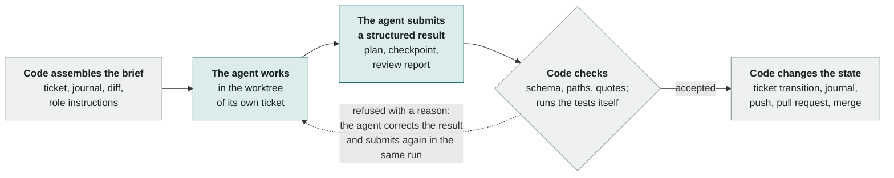
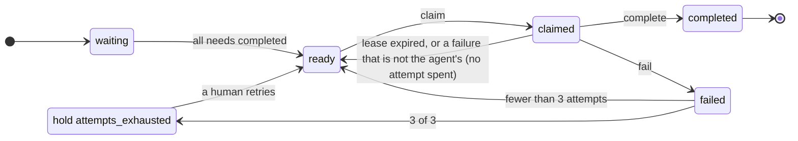
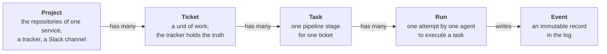

# How istari works

istari takes a ticket from creation to a merged pull request. Agents do only the work that needs judgment: they refine the ticket, write the plan, the code and the review. Code decides everything else: who works next, whether a result is accepted, and when the ticket moves on.

This page is an overview of [`design.md`](design.md), sections 2, 4 and 7.7. Where the two disagree, the spec wins.

In the diagrams, the colour of a box says who acts there:

| Colour | Who acts |
|---|---|
| Teal | an agent |
| Grey | istari's code |
| Amber | a human |

## The path of a ticket

A ticket is a state machine with eight states. It moves only along the arrows below. Code performs every transition, and only when the condition on the arrow holds.

```mermaid
flowchart LR
    s_new["<b>new</b><br/>checked against the standard<br/><i>refiner</i>"]
    s_ready["<b>ready</b><br/>waits for a free slot<br/><i>queue</i>"]
    s_planning["<b>planning</b><br/>technical plan<br/><i>planner</i>"]
    s_progress["<b>in_progress</b><br/>code, tests, CI<br/><i>implementer</i>"]
    s_review["<b>in_review</b><br/>review of the pull request<br/><i>reviewer</i>"]
    s_approval["<b>awaiting_approval</b><br/>approval and merge<br/><i>human</i>"]
    s_done["<b>done</b><br/>pull request merged,<br/>ticket closed"]
    s_children["child tickets<br/>each starts at <b>new</b>"]

    s_new -->|"T2 · meets the standard,<br/>admitted"| s_ready
    s_ready -->|"T3 · free slot,<br/>needs done"| s_planning
    s_planning -->|"T4 · plan accepted,<br/>change zone free"| s_progress
    s_progress -->|"T6 · pull request open,<br/>CI green"| s_review
    s_review -->|"T8 · no findings"| s_approval
    s_approval -->|"T11 · approved,<br/>merged"| s_done

    s_review -.->|"T7 · findings"| s_progress
    s_approval -.->|"T9 · human requests changes<br/>T10 · conflict with main"| s_progress

    s_planning -.->|"T5 · larger than max_size:<br/>split"| s_children
    s_children -.->|"T12 · all children done"| s_done

    classDef agent fill:#dcecea,stroke:#0d6b68,color:#1b2422
    classDef code fill:#eef1ee,stroke:#8a9692,color:#1b2422
    classDef human fill:#f5ead2,stroke:#a9770f,color:#1b2422
    classDef dashed fill:#ffffff,stroke:#8a9692,color:#1b2422,stroke-dasharray:5 4
    class s_new,s_planning,s_progress,s_review agent
    class s_ready,s_done code
    class s_approval human
    class s_children dashed
```

- **Verify.** Between the implementer and the reviewer there is a `verify` stage with no agent. Code waits for green CI and then marks the draft pull request ready for review.
- **Split.** The parent of a split ticket has no tasks of its own. It waits in `in_progress` until every child is `done`.
- **Rework.** A ticket returns for rework at most `max_review_rounds` times. A round caused by a conflict with the main branch does not count.
- **Cancel.** A human can cancel a ticket in any unfinished state (T13): its runs are stopped and its pull request is closed. `reopen` returns a canceled ticket to `new` (T14).
- **No way back from `done`.** A regression is filed as a new ticket that links to the original one.
- **Edits.** Editing the mandatory sections of a `ready` ticket sends it back to `new` to be checked again (T15).

### Who admits a ticket

Anyone can create a ticket: a human in the tracker, an agent, a Slack message. A ticket goes into work only when it meets the ticket standard and one of these holds:

- its author is trusted;
- an agent created it while working on an admitted ticket;
- a trusted member admitted it by hand.

## One stage: the model proposes, code decides

Every stage that an agent works on has the same shape.

An agent cannot move a ticket to another state, lift a hold, merge a pull request, change a priority or a budget, or declare the checks passed. It has no GitHub token: only code pushes a branch, opens a pull request and merges it, and only for the branch of the agent's own ticket.

| Role | What the agent does | What code checks |
|---|---|---|
| `refiner` | Assesses the quality and the size of the ticket and rewrites it to the standard | The mandatory sections are in place; the original text is preserved verbatim |
| `planner` | Writes the plan and the change zone; splits the ticket when it is too large | The zone's paths exist; the zone's size matches the ticket's size |
| `implementer` | Writes code and tests in small slices | Code runs the checks at every checkpoint; a new test must fail on the previous code; the full suite runs before the pull request is opened |
| `reviewer` | Looks for findings on two axes: the standards, and the ticket | The file and line of each finding are in the diff; the quote is in the ticket or the standard. A finding that fails is dropped |

The reviewer and the implementer are always different agent profiles. An agent does not review its own code.

## Tasks, attempts and holds

Each stage of a ticket is a task. One attempt to execute a task is a run of an agent. A failed run returns the task to the queue until its attempts run out.

- **Lease.** A claimed task is leased for 5 minutes, and the runner renews the lease while the run lives. When a lease expires, the task returns to `ready`.
- **What costs an attempt.** Only a refusal about the submission itself: a result outside its schema, a YAML error, a finding outside the diff.
- **What does not.** A review handed out before the ticket is `in_review`, or a harness that does not start, spends no attempt: the task is released to `ready`.

### Holds

A hold is a flag on top of any unfinished state, not a state. While it is set, the ticket's tasks are not handed out. When it is cleared, the ticket continues from the same place.

| Reason | When it is set | Who clears it |
|---|---|---|
| `needs_input` | An agent asked a question; or the main branch fails the full suite too | A human, by answering |
| `attempts_exhausted` | A task failed `max_attempts` times; or the review rounds are used up | A human, with `retry` |
| `budget_exceeded` | The ticket's budget is spent | A human, by raising the budget |
| `paused` | A human paused the ticket | A human, with `resume` |
| `waiting_dependency` | A ticket in `Needs` is not `done` | Code, when every need is `done` |
| `waiting_zone` | The change zone overlaps the zone of a ticket in progress | Code, when that ticket is merged or canceled |

## Who merges the pull request

| Mode | Who approves | Who merges |
|---|---|---|
| `manual` | A human | A human |
| `after_approval` (default) | A human, with a GitHub review | istari, right after the approval |
| `auto` | Nobody: a passed agent review and green CI are enough | istari |

In `auto` mode a pull request is merged without a human only when all of these hold:

- the ticket is small (`auto_max_size`, `S` by default);
- the reviewer left no findings and CI is green;
- the agents recorded no assumptions;
- the change touches no irreversible paths (migrations, public interfaces, deployment).

In every mode a human may merge the pull request before istari does. The ticket then moves to `done`.

## What it is built from

All state is a projection of the event log.

### No ticket, no work

The invariant is enforced at five levels, so that no interface goes around it:

1. **Storage.** A run cannot be written without its task, nor a task without its ticket.
2. **API.** There is no operation that starts an agent with an arbitrary prompt.
3. **Ticket standard.** Only a ticket that passed the standard check and admission goes into work.
4. **Git.** The branch is named after the ticket, and every commit carries a `Ticket:` trailer.
5. **CI.** The required check `istari/ticket-link` rejects a pull request without a link to an open ticket.

### What survives a failure

The ticket, the branch and the pull request hold everything the work needs. The istari database, harness sessions, workspaces and Slack are expendable: if they are lost, work resumes from the last checkpoint in the ticket's journal.
